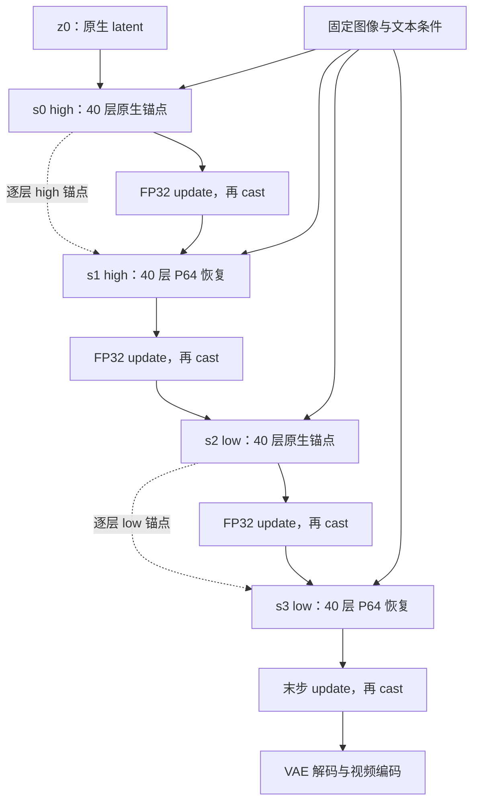
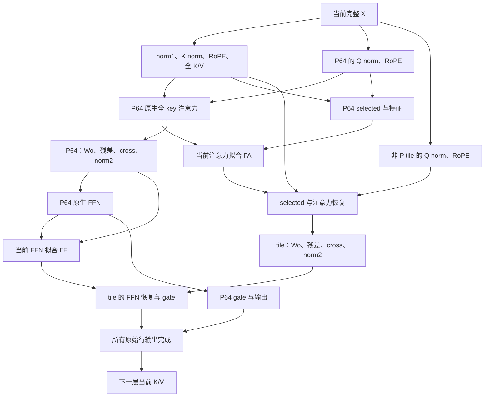

# FFNDS：HHLL 全过程的时间、状态与计算因果图

## 结论与对象

当前方法可以用一条闭合的计算图描述：**在每个 expert 的第一步建立逐层锚点，在同 expert 的第二步用当前输入、当前 P64 原生观测和该层锚点恢复注意力及 FFN 的非 P 输出。** 它覆盖两个子模块、两种噪声 expert 和四步完整轨迹。注意力与 FFN 的联系经过真实的输出投影、残差、cross attention、归一化和调制；这些中间节点决定了观测何时可用。

已实现的 probe-first 调度把同层 P64 链提前，允许非 P 行随后按 tile 完成整个块，减少一部分全场中间量。它保留了当前层完整 K/V、两个当前 P64 拟合、原始位置索引、下一层当前 K/V 所需的全位置输入。实测结果说明，这个改写已获得可执行性和显存上的证据，尚未获得延迟收益。跨层 tile→下一层 K/V 的进一步流水，以及固定条件的文本 K/V 跨步复用，仍是有明确条件的未实现改写。

本文件基于当前冻结方法与实际优化源码。`CAUSAL_GRAPH.json` 展开两套 **4 步×40 层** 图：冻结 centered wide8192 与实测 `09_combined_graph`。图中事件是源码算子边界；节点数不是 kernel 调用数。所有微节点的持续时间为 `null`，已有 GPU event 时间只附于整个去噪步骤。

## 1. 三种时间和真实空间

| 符号 | 含义 | 当前范围 |
| --- | --- | --- |
| $s$ | 去噪计算步；实际物理噪声条件另记 $\sigma_s,t_s$ | $0,1,2,3$，expert 顺序 HHLL |
| $\ell$ | 当前 expert 内的层号 | $0,\ldots,39$ |
| $f$ | latent 视频帧坐标 | $0,\ldots,20$ |
| $n$ | 当前层的原始 token 行号 | $n=(29f+y)52+x, N=31668$ |
| $\tau$ | 源码边界提交的逻辑事件顺序 | DAG 中严格拓扑顺序，不是秒 |
| $h,\alpha$ | attention head 和 head 内通道 | $H=40, d_h=128, d=5120$ |

真实 latent 为 `[16,21,58,104]`；patch size `(1,2,2)` 后为 `[31668,5120]`。输出视频为 81 帧，不能将 81 帧、21 个 latent 帧、4 次 denoise 调用当作同一种时间轴。注意力的原生探针使用 `is_causal=False`：视频帧的先后不构成这里的自回归屏障。

P64 坐标来自 `evidence/base_identity.json`，保留其原始顺序；文件 SHA256 为 `e54bd777d957f53012833c0e70870df445f9e52d1e0bb9dfa51d9235dbe8c630`。实际探针覆盖 19/21 latent 帧，没有落在 $f=7,15$。非 P 行按原始行号升序分成 `8192,8192,8192,7028` 四个 tile。覆盖 19 帧是观测位置的事实；既不证明其余帧没有信息通路，也不证明该观察集合足以恢复任意视频场。

## 2. 全过程：当前状态经完整网络进入下一步



图中的每个 40 层节点包含专家自身的 patch/text/time embedding、40 个块、final norm/time modulation/head、unpatchify。$s=2$ 使用 low expert，锚点全部在当前候选轨迹输入上重新建立；此前误差已通过 $s=1$ 的 scheduler 输出进入该输入，因此原生锚点不等于轨迹回到 Dense 参照。

### Scheduler 已闭合的部分

`joint_graph/native_step_scheduler.py` 的 SHA256 为 `2d560449e0559aea44d80afb539f9e97bd544e5e26abcc06236e61918d01e1db`，与 `base_identity.json.scheduler_sha256` 相同。读取 `Wan22StepDistillScheduler.step_post` 得到以下实际计算顺序：

\[
v_s=\operatorname{FP32}(\mathrm{noise\_pred}_s),\qquad
u_s=\operatorname{FP32}$z_s$-\sigma_s v_s,
\]

\[
\widetilde z_{s+1}=
\begin{cases}
u_s+\sigma_{s+1}v_s,&s<3,\\
u_s,&s=3,
\end{cases}
\qquad
z_{s+1}=\operatorname{cast}_{\mathrm{dtype}$z_s$}(\widetilde z_{s+1}).
\]

当前审计绑定的原生 latent dtype 是 BF16。实数代数可写为 $z_{s+1}=z_s-(\sigma_s-\sigma_{s+1})v_s$，但实际 FP32 两次运算再 BF16 cast 不能用这一单表达式声称逐位相等。此子类未调用父类 `WanScheduler.step_post` 的 UniPC 更新，所以没有 `model_outputs`、`last_sample` 等求解器历史输入。图像条件在网络 `pre_infer` 拼接，不在此 update 中回写 prefix。expert 边界本身也没有额外 re-noise。

**数值噪声表保留一个明确绑定缺口。** 历史审查在 `denoising_step_list=[1000,750,500,250], sample_shift=5` 条件下得到实数参考 `[1,15/16,5/6,5/8,0]`；历史 FP32 记录是 `[1.0,0.9375,0.8333333134651184,0.625]`。最新 pilot JSON 没有重新公开 sigma 数值，归档 render 只在运行时对外部 `base.json` 做逐步断言。因而机器资产把最新数值表标为 `OPEN_BINDING`，不将历史数字冒充新 receipt。当前因果图与无求解器历史的结论不依赖该数值缺口。

**整个方法仍然有跨步记忆。** Scheduler 没有多步历史，不意味着 FFNDS 仅以 $z_s$ 为充分状态。应使用扩展状态

\[
Z_s=(z_s,\mathcal S_s^{\rm attn},\mathcal S_s^{\rm FFN},e_s,\text{source/condition/weights/coordinates identity}).
\]

这同时保留了当前 latent、锚点状态和合法失效条件。跨 expert 可以复用物理内存，不能复用前一个 expert 的数学状态。

## 3. 一个块的真实组合与信息屏障

固定 $s,\ell$，以下表达省略对应 expert/layer 权重标签，但所有参数均有该归属：

\[
u^A_n=\operatorname{Mod}^A_{s,\ell}(\operatorname{LN}_1(x_n)),\quad
q_n=R_n\operatorname{QNorm}(u^A_nW_Q+b_Q),
\]

\[
k_n=R_n\operatorname{KNorm}(u^A_nW_K+b_K),\qquad
v_n=u^A_nW_V+b_V.
\]

\[
\widehat a_n=\widehat{\operatorname{Attn}}(q_n,K_{1:N},V_{1:N};\mathcal S^A,P),
\quad
r_n=x_n+g^A_{s,\ell}\odot(\widehat a_nW_O+b_O),
\]

\[
b_n=r_n+\operatorname{CrossAttn}(\operatorname{LN}_3(r_n),C_e),\quad
u^F_n=\operatorname{Mod}^F_{s,\ell}(\operatorname{LN}_2(b_n)),
\]

\[
x'_n=b_n+g^F_{s,\ell}\odot\widehat F(u^F_n;\mathcal S^F,P).
\]

CrossAttn 框含 native cross Q/K norm、文本 K/V、softmax/value contraction、输出投影及偏置。它在固定文本 K/V 后按 query 行独立。LN 与调制也按行处理；将这些尾部移到 P64 或非 P tile 上是源代码调度改写的依据。



为使图紧凑，未画出静态 CAL、两个锚点和 text K/V 向对应节点的边；机器 DAG 全部保留。这张图画的是信息依赖：P64 原生注意力结果沿 P 尾链进入原生 FFN，不经过注意力拟合的非 P 预测。`prepare_attention` 的现行 API 仍先算完拟合再返回真值；这是实际执行顺序，不能误认为 P 尾链在数学上依赖拟合系数。

### 三种屏障必须分别命名

| 屏障 | 因果要求 | 当前实现 | 可变化范围 |
| --- | --- | --- | --- |
| 全 key 信息 | P64 原生注意力的最终结果需要所有 current key/value 的贡献 | 先完成完整 K/V 数组，再调用 native teacher | online softmax 可以逐 key tile 累积；最终归一化仍须等待所有贡献 |
| 全 P64 拟合 | 当前全局读出依赖完整 P64 观测和对应特征 | 先 fit，再恢复非 P 行 | 可改变求解/提交顺序，保持同一拟合目标；不能使用未来拟合系数编码过去锚点 |
| 层边界 | 下一层的 K/V 由本层更新后的行产生 | 所有本层行 scatter 完成后才进入下一层 | 可以逐行/tile提前生产下一层 K/V；不能提前完成依赖尚未到达 key 贡献的精确 P64 结果 |

完整 K/V **物化**是当前 kernel API 的要求；全 key **贡献**是这里原生观测的因果要求。两者不能合并成关于所有算法的存储下界。相应地，图没有把全 K/V 物化标记为信息论下界。

## 4. 三个执行层次的精确区别

| 对象 | 已实现的执行内容 | 与图中目标的关系 | 当前实测判断 |
| --- | --- | --- | --- |
| 冻结 centered wide8192 | 全场 norm1/QKV；全场注意力恢复；全场 Wo/cross/norm2；FFN 在完整当前输入上 P64 fit，再按 8192 行构造结果、覆盖 P；每层完整输出后进入下一层 | 当前有效基线 | 继续作为参照 |
| 已实现 probe-first whole-block | 全场 K/V 先就绪；P64 真值链走至 FFN fit；随后非 P tile 穿过整个块；最终 scatter | 实数意义下的同目标行调度，GEMM 和归约形状改变，有限精度需实测 | profile04 wall speedup 0.901325×，峰值少 1.237405 GiB |
| 已实现 combined_graph09 | 上述 whole-block；另外替换 low anchor 为 selected/omitted partition 重组，并做 high output fold 等配置 | 多个已实现改写组合；不能将其全部开销归因于 probe-first | wall speedup 0.815985×，峰值少 1.057354 GiB |
| 未实现进一步流水 | 当前 tile 输出即生产下一层 K/V；P真值尾链与独立拟合调度；同 expert/layer 固定文本 K/V 复用 | 具有明确依赖条件的算法/调度候选 | 未测，不记入当前速度或缓存成绩 |

whole-block 当前额外代价已从代码定位：为避免保存完整 norm1/Q，后续 Q 阶段重算 norm1 与调制；单输入 RoPE 调用借用双输入 backend 并复制输入、计算一个无用第二输出；多个 tile 改变 GEMM 形状与 kernel 调度；gate 从基线的 full-field fused 路径转到 row native 路径。这些是实际新增工作，能解释为何“少存中间量”不足以保证更快；各项究竟占多少秒，当前 step event 无法分解。

### 同一组五源配对的 coarse event 时间

| 步骤 | frozen 均值/s | combined_graph09 均值/s | 差值/s |
| --- | ---: | ---: | ---: |
| s0 high anchor | 7.949433 | 7.922149 | -0.027284 |
| s1 high hit | 4.233985 | 5.489317 | +1.255332 |
| s2 low anchor | 8.906716 | 13.808579 | +4.901863 |
| s3 low hit | 4.308828 | 5.783698 | +1.474870 |

这是 `EXECUTION_LEDGER.json` 由实际 pilot 重算的四步 event 均值。$s=2$ 占本组合 GPU event 总增加量的约 64.46%；该 profile 的 low anchor partition 是单独配置变化。它支持“额外成本主要落在此阶段”的定位，不能替代 partition kernel 的实测利用率或逐 kernel 归因。整个请求 wall 的差值为 +7.451416 s，和 step event 差值总和 +7.604781 s 不同；请求包含另外的编码/解码/视频保存等工作，不能把两者互换。

## 5. 锚点、拟合系数与物理缓存的生命周期

| 状态 | 产生事件 | 使用事件 | 生命周期与复用 |
| --- | --- | --- | --- |
| high route | s0、每层当前 Q/K 路由完成 | s1 同层 selected attention | 不传给 low expert |
| low route、rho、C、A | s2 同层原生/selected 注意力及当前值统计 | s3 同层 centered base 和 OUT-D readout | 对应 source、expert、layer、token layout；s3 最后读取后失效 |
| FFN u0、y0、z0k | s0/s2 同层 cross 后 norm2/modulation 输入和原生 FFN | s1/s3 同层当前输入的 secant/base 与 P64 fit | 40 个物理层槽；high 消耗完才写 low |
| ΓA、ΓF | s1/s3 同层当前 P64 数据齐备 | 本次层调用的非 P 行 | 与当前输入绑定，不跨步当作同一状态 |
| FFN/CAL 常量 | 离线，按 expert/layer 固定 | 相应 expert/layer 各次调用 | 80 个 expert/layer 常量站点；与 40 槽动态状态不同 |
| text K/V | 当前模型 pre text embedding 后、每层 cross 路径 | 本次层调用所有行/tile | 当前每四步×40层重做，共160次；尚无跨步缓存 |

`ProjectedAnchorSlots.take` 清空逻辑 `owner`，返回仍指向缓存存储的视图。此时数据尚有当前层的消费者，不能解释为 GPU 字节可立刻覆盖。机器图分别记录 `write → take → last_read → borrow_end`，再验证同一物理槽的 low 写入在 high 最后一次消费之后。当前串行 HHLL 调度满足该次序；未来异步跨层流水必须另加 stream/event 生命周期合同。

text K/V 可复用的充分条件包括：同一 source/condition、同一 expert、同一 layer、相同权重版本、相同 dtype 和 context 行序。high/low 的 text embedding 与 cross 投影权重不同。当前代码每次 `infer_cross_attn` 或 streamed `prepare_global` 都执行文本 K/V，因此本报告只把这项记为候选，未计入现有缓存或速度。

## 6. 与源码一致的 baseline 伪码

```python
# 固定 P64 原始索引，固定 80 组 expert/layer 常量；动态槽按层分配 40 份。
z = initialize_and_native_cast(seed=42)
for s in range(4):
    e = "high" if s < 2 else "low"
    scheduler.step_pre$s$  # dtype 和 timestep_input
    X, context, embed, rope = native_pre_infer(z, fixed_condition, expert=e)

    for l in range(40):
        fields = native_six_modulation_fields(embed, weights[e, l])
        U = norm1_then_modulation(X, fields)
        Q = q_norm(q_projection(U))
        K = k_norm(k_projection(U))
        V = v_projection(U)
        Q, K = native_paired_rope(Q, K, rope)  # 全场原始行序

        if s in (0, 2):
            route = route_from_current_QK(Q, K)
            A = native_all_query_attention(Q, K, V)
            if s == 2:
                S = selected_attention(Q, K, V, route)
                attn_slots[l] = centered_low_anchor(A, S, V, route, CAL[e, l])
            else:
                attn_slots[l] = route
        else:
            state = attn_slots.pop(l)  # same expert 的前一步锚点
            S = selected_attention(Q, K, V, state.route)  # 先完成全场 selected
            P_truth = native_attention(Q[P], K, V)       # 当前全 K/V
            A = fit_and_restore_attention(S, P_truth, V, state, CAL[e, l])
            A[P] = P_truth

        R = X + fields.gate_A * native_Wo(A)
        Qtext = cross_q_norm(cross_q_projection(norm3(R)))
        Ktext, Vtext = native_text_KnormV(context, weights[e, l])
        B = R + native_cross_Wo(native_cross_attention(Qtext, Ktext, Vtext))
        UF = norm2_then_modulation(B, fields)

        if s in (0, 2):
            Z = native_W1_bias(UF)
            ffn_slots[l].copy_selected_pre(Z[:, selected2560])  # z0k 必须在原地 GELU 前复制
            gelu_tanh_(Z)  # 原地激活后 Z 已不再是 preactivation
            Y = native_W2_bias(Z, out=ffn_slots[l].y0)  # baseline 已有 direct write
            ffn_slots[l].copy_input(UF)
        else:
            old = ffn_slots[l].borrow_same_expert(e)
            YP = native_FFN(UF[P])  # 对 candidate 当前 UF 的局部真值
            fit = fit_FFN_P64(UF[P], YP, old, frozen_constants[e, l])
            Y = empty_like(UF)
            for rows in full_row_tiles(N=31668, tile_rows=8192):
                Y[rows] = restore_FFN_rows(UF[rows], old, fit)
            Y[P] = YP
            old.end_borrow_after_last_read()

        X = baseline_fused_gate_residual(B, Y, fields.gate_F)
        # 该全场输出完成后，下一层才产生其 current K/V。

    flow = native_head_and_unpatchify(X, embed).float()
    u = z.float() - sigma[s] * flow
    if s < 3:
        u = u + sigma[s+1] * flow
    z = u.to(native_latent_dtype)
video = native_VAE_decode_and_video_encode(z)
```

伪码刻画算子边界及状态次序，不用于替代生产代码。BF16 cast、原生 `.apply`、分支及缓存 direct-write 在实际实现中必须按绑定源码处理。

## 7. 已经可证明的流水机会及它们的条件

若第 $\ell$ 层的输出 tile $X'_{I}$ 已完成，下一层的 norm1、调制、K projection/K norm、RoPE 和 V projection 对这些行都只需 $X'_I$ 与固定位置/条件，可以开始生产 $K^{\ell+1}_I,V^{\ell+1}_I$。这给出合法的 producer-consumer 流水顺序。它不允许把下一层的 P64 原生结果只用已到达的 key 子集提前定稿。

对于精确 softmax，逐 key tile 可维护每个 query/head 的 running max、归一化和与加权值和。因此完整 K/V 数组不是数学上唯一执行表示；但最终输出和 low 当前全局 value moments 均要等所有相应贡献齐备。将这些步骤融合到本层输出的 producer，需要新的 kernel、缓冲布局、probe accumulator、数值路径及事件所有权；目前 whole-block adapter 没有实现。

令 $G=(V,E)$ 是信息依赖图，$\mu_v$ 是真实测得的节点持续时间，则任何合法调度满足

\[
\operatorname{start}(v)\ge\max_{u\to v}\operatorname{finish}(u),\qquad
T\ge\max_{\pi\ \mathrm{path}}\sum_{v\in\pi}\mu_v.
\]

还需资源串行、带宽、占用等约束才能预测 wallclock。当前只有四个 macro event，无法求解这个微观关键路径下界，更无法将“可改拓扑”升级为“已接近最优”。本轮得到的是可逐项验证的改写位置和保留的信息屏障，后续性能主张应对应新的执行证据。

## 8. 可复查资产与验收范围

在本目录执行即可复现；`GRAPH_INPUTS.json` 含真实 P64、source catalog 与已有 macro timing，不依赖原会话临时目录：

```bash
python build_graph.py
python verify_graph.py
```

可用 `--inputs`/`--output` 指定生成器输入输出，验证器接受 `--graph`/`--output`。默认验证检查机器图与所引元数据，不宣称重新读取了原始源文件。若持有本审查的源文件树，再传 `verify_graph.py --source-root /path/to/evidence-root` 逐项重新核 SHA256。本次 `GRAPH_VERIFICATION.json` 记录的是实际检查18份本地源文件后的结果；另将脚本和输入单独复制到新目录重建，生成图逐字节相同，见 `PORTABLE_REPRODUCTION.json`。

结果：两张图通过无环、逻辑提交顺序、无未来输入、无跨 expert/layer 缓存、全部 current-key 前提、当前 P64 fit 前提、cross 后 FFN 输入、所有原始行覆盖、40 槽最后读取先于覆盖、80 组静态常量、160 次文本 K/V 重算等检查。真实 P64 与非 P 划分也校验了原始索引与 SHA256。

| 图 | 节点 | 信息依赖边 | P64 attention native query 数 |
| --- | ---: | ---: | ---: |
| frozen centered wide8192 | 5,561 | 12,668 | 5,120 |
| combined_graph09 | 10,801 | 26,268 | 5,120 |

节点按不同 tile/边界粒度展开，所以两图节点数量不能作为 kernel 数或成本比较。源码指纹共18项；正式验证报告是 `GRAPH_VERIFICATION.json`。当前验证是 CPU 上对源码抽象的校验，不是捕获实际 GPU 异步轨迹；没有运行新 GPU、没有更改生产路径，也没有宣称新性能结果。

主要证据入口：`joint_graph/native_transformer_infer.py` 的 `infer_block/infer_self_attn/infer_cross_attn/infer_ffn`；`joint_graph/pre_infer.py`、`post_infer.py`；`joint_graph/native_step_scheduler.py`；`round21_impl/source/tools/ffnds_fourstep/fourstep_hit.py`；`round21_impl/repo/tools/ffnds_optim/{block.py,runtime.py,attention_runtime.py,ffn_runtime.py}`；修正后 `round22_review/source/tools/ffnds_optim/wan_block.py`；`round22_review/mechanism/EXECUTION_LEDGER.json`。每个对应文件的 SHA256 在机器图内完整列出。
