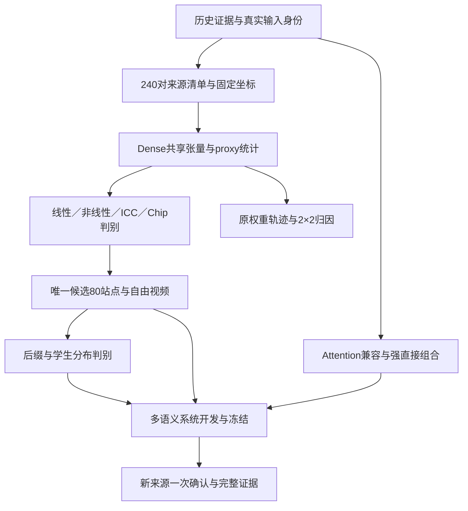

# G20 实验路线 v3：语义覆盖、可辨识对照与资产依赖

**2026-11-12 · DESIGN_REVISED · 本次交付为方案与资产编排；新实验须逐 scope 复审、登记与实际运行。**

证据基点：`main@1636c83a78fabd4dfd2f08611a6828c7386a366c`。本文件接替 [11/11 路线 v2](../20261111/G20_NEXT_EXPERIMENT_ROUTE_AND_DECISION_TESTS_20261111.md) 的未来执行顺序；[双主线合同](../20261111/G20_TWO_TRACK_OPERATOR_AND_DISTILLATION_ATTRIBUTION_20261111.md) 的新算子／权重与轨迹归因目标继续有效。历史 scope、原始结果及冻结清单保留。

**执行阅读顺序**：本文 → [图文来源与采样规格](G20_COHORT_AND_SAMPLING_SPEC_20261112.md) → [机器执行队列](G20_EXECUTION_QUEUE_20261112.json) → [当前资产树](G20_ASSET_REGISTRY_20261112.json) → 对应 scope 的独立评议与 [ACTIVE](../ACTIVE_RESEARCH.json)。图文配额与 240 个规划槽位见 [cohort manifest](../../config/g20_semantic_cohort_v1_20261112.json)。资产树是指向原始凭证的派生索引，实际运行授权仍只由 ACTIVE 与逐 scope 收据决定。

## 1. 本轮决定及已有结果

研究要回答：**Q1 的优势来自什么表示与数据条件；哪些剩余误差确实值得用额外在线计算修正；这些修正能否在多语义视频及强 Attention 组合下兑现质量和时间收益。** 扩数据、引入非线性、改 ICC、改 proxy 是有竞争预测的分支，不预先把所有失败归因于数据不够。

| 已有证据 | 本轮采用的判断 | 对实验的影响 |
| --- | --- | --- |
| [R1](G20_R1_SAME_INPUT_SCREEN_RESULTS_20261112.md)：旧 CAL4／DEV5、seed 42、80 站点统计与 6 站点拟合 | Q1 保持已测强参照；旧源只具开发身份 | 复用数据，不重复 80 站点旧筛查，不把旧源当新确认 |
| [R1b](G20_R1B_NUMERICAL_RECHECK_RESULTS_20261112.md)：F64 稳定解、正确秩、正规方程与独立解交叉验证 | 当前六站点主求解疑点闭合；稳定主 λ 的 DEV 平均相对退化仍为约 15.1%–28.4%，强 λ 仍退化 | 后续拟合沿用稳定求解语义；新的核心问题是泛化、修正方向与表示 |
| 稳定解与原解的净退化最大差约 0.83 个百分点 | 这次数值修复未消除主要 DEV 退化 | 不将“保留 ≥97% 净退化”写成过拟合原因的因果占比 |
| ICC `svd_r512 / ffnds_two_residual` 分解：stage-2 占 DEV 总误差约 64%–82% | 原生 hidden 上的第二级读出是优先判别对象 | 先核验并比较已有 CD-SVD 因子，再决定固定总秩预算的重分配 |
| Chipmunk 作者块均值臂缺完整分组数据；旧 global-P64 已有真实结果 | 作者算法与旧适配分开 | 在新共享采集中流式产生完整分组统计，避免再用散点均值替代 |

证据口径同时更正：R1b 所报原 D 越出 CAL 行空间的 **0.42%–0.86% 是 Frobenius 范数比例**，平方后能量比例约 **0.00179%–0.00744%**；小参数能量本身不推出小预测影响。ICC high/4 的源等权绝对 MSE 略优于 Q1，而平均逐源相对差变差，不能写成六站点在所有聚合下均劣。后续统一保存绝对误差、逐源相对差及比值的分子分母。`omega` 是输入行空间诊断，不是输出误差或视频质量上界。

## 2. 核心问题与决定性实验

| 问题 | 竞争解释 | 直接判别 | 回答后采取的动作 |
| --- | --- | --- | --- |
| Q1：自由线性修正为什么伤害 DEV？ | 修正方向错误／方向有用但过冲；来源广度／行密度不足；自由度过大 | L0 方向—幅度分解；L1 来源×行数对照；固定与 CAL 内选择的正则政策；受限线性对照 | 保留可泛化的表示；只在学习曲线支持时追加 CAL |
| Q2：需要端点状态的非线性吗？ | 更好线性估计足够；仅位移非线性足够；中点／端点状态提供有效信息 | N1 在同 bank 上比较嵌套线性、端点非线性、仅位移非线性 | 决定是否为在线状态投影和非线性付费 |
| Q3：ICC／Chipmunk 的差距出在哪？ | 因子拟合与读出／秩预算／中间误差；proxy 选错／稀疏预算本身不足 | B1 ICC 两级及交叉项；B2 忠实 proxy、同 K 对照和有限 mask 修复 | 修正明确环节；保留实际可执行的最近邻强基线 |
| Q4：局部改进为何不能兑现为视频改进？ | 下游低敏感／误差方向错误；学生状态分布偏移；跨层与专家交互 | T1 实际候选方向后缀；T2 来源配对自由运行；必要时 high/low 因子与同 CAL 学生校准 | 改校准状态／目标，或停止当前候选 |
| Q5：差异来自权重、轨迹还是间隔？ | 权重函数变化；输入位移／时间间隔变化；两者交互 | D1 同源、同 gate 的权重×状态交叉函数回放，并显式匹配实际时间与位移 | 给出 Wan 内有条件归因；不从两个 Wan 权重直接宣称架构因果 |
| Q6：新方法有额外系统价值吗？ | 只改善局部 MSE；只增加 FFN 算力；优于 Q1＋强 Attention 的直接组合与实际最近邻 | S1 七臂开发；S2 冻结候选后的新源确认，质量、运动、语义和真实 wall-time 联合判据 | 决定系统主张或保留机制结果 |

Q1–Q3 共用同一来源与张量 bank，允许并行；D1 是并行解释线，不要求先出现新算子胜者。T1/T2 要有合法可部署候选；没有胜者时，可用 native correction 做范围明确的传播诊断，不能据此宣称候选有效。

## 3. 图文对规模与采集顺序

### 3.1 基础配额

| 用途 | 独立原始图像簇／主图文对 | 每个语义层 | 生成 seed | 用途边界 |
| --- | ---: | ---: | --- | --- |
| CAL | 96 | 8 | 42 | 拟合、特征与支持选择、CAL 内调参；不在 DEV 拟合 |
| DEV | 48 | 4 | 42、43 | 方法筛选、误差分解、方差估计、系统开发；看过即暴露 |
| CONFIRM | 96 起，冻结前可改为 144 或 192 | 8 起 | 42、43 | 算法、阈值与样本量冻结后一次性确认 |
| 基础总数 | **240** | **20** | seed 是源内重复 | 不能以 crop、改 prompt、相邻帧或重复 seed 增加独立 n |

12 类主语义与每条槽位的子主题、图像要求、动作／镜头文本见配套规格。主体、手部、人与物交互、多主体、陆生动物、飞行动物、水生场景、交通、自然、建筑、物体／机械及风格化／虚构场景覆盖由真实图像验收；相机、运动强度、遮挡、尺度、纹理和光照为交叉标签。每类 8 个确认源只支持总体分层估计和描述，不能保证该类独立非劣结论。

**240 是必须绑定的计划规模，不是已采集数量。** 当前已读清单能核实 fresh10 与 new12 共 22 条带图像／prompt 身份的历史来源，均有开发暴露；不能拿它们充当 96 个新确认源。先从有访问与使用依据的数据池筛选实际独立簇；不足的语义层补来源，完成图像可读性、内容匹配、原始视频簇、近重复和全部可追溯暴露审计。`UNBOUND` 槽位不得进入 runner；输入审查只看图像／文本，不看确认集模型结果。历史未知的确认候选替换或标为不合格。

### 3.2 一次采集、多次子采样

每源冻结一份 **跨 4 步、40 层及方法臂共享的 2,048 行有序均匀面板**；256／512／1,024／2,048 是它的嵌套前缀。另存 336 个 tubelet 行用于时间结构，单独记录抽样权重与坐标；不与均匀面板直接混合平均。现有某些 row-draw 工具把 step/block 编入随机种子，需在 producer 中实现本合同的 source-level 面板，不能只改配置名称。

校准主学习曲线：`12/24/48/96 源 × 256 行`。固定 **24,576 行／站点** 的来源广度对照：`12×2048、24×1024、48×512、96×256`。同来源密度对照：`96×256` 与 `96×1024`。所有集合按语义均衡嵌套；保留三套事先固定的 CAL 子集排列以检查小样本子集偶然性，它们是相关重复，不扩充独立 n。主结论至少报告主排列及另外两排列的方向；不挑最有利子集。

采集按三波推进，完成一波立即检查完整性和共用分析，不等待所有数据到齐才发现接口错误：

| 波次 | 新增 Dense 原生四步轨迹 | 累计 | 执行目的 |
| --- | ---: | ---: | --- |
| C1 | CAL24＋DEV12，seed42：36 | 36 | 12 类覆盖；其中前 2 条兼作 capture／neutral pilot，不另加重复 pilot |
| C2 | 新增 CAL24＋DEV36，seed42：60 | 96 | 得到 CAL48／DEV48 的同输入比较 |
| C3 | 新增 CAL48 seed42＋DEV48 seed43：96 | 192 | 完整 CAL96、两 seed DEV48，完成预定学习曲线 |

主 bank 保存全 160 调用的 U、**真实 Dense Y**、gate、坐标、noise／scheduler／conditioning 身份。Q1 或候选 hit 的 `Y_used` 必须标方法输出；不能当 Dense target。学生状态的 native target 属额外付费 shadow／回放，记录其真实计算范围。

逻辑存储上界：每轨迹 `160×2384×2×5120×2` bytes ≈ **7.275 GiB**；192 条约 **1.364 TiB**，不含完整恢复包、Z/H、proxy、视频、副本及暂存。128 行原生 Z/H 全调用诊断额外约 1.055 GiB／Dense 轨迹，可只对冻结六站点保存；不能无记录改成全层额外采集。采集前按实测 producer 容量账本冻结磁盘与保全预算；若当前存储不足，采用分片／冷存或经复审调整范围，而非静默减少有效行或丢弃坐标。

## 4. L0/L1：线性失败的方向、幅度与数据因素

### 4.1 先区分过冲和错误方向

从已有 R1b 稳定矩阵与对应旧 bank 复用一次前向算术，记录每源、站点的

\[
e=G\odot(\Delta Y-XA_0),\quad c=G\odot XD,\quad
a=\langle e,c\rangle,\quad b=\|c\|^2,
\]
\[
R(\eta)-R(0)=\eta^2 b-2\eta a.
\]

若 `a≤0`，任何正小步修正都不能沿该方向降误差；若 `a>0` 而 `b>2a`，单位幅度过冲，但存在正幅度下降区间。`a/b` 是每个已观察评估源的**事后诊断量**，不作为该源部署选择器；合法 shrink 只能在 CAL 的来源留出内选择并冻结。`b=0` 单列无修正，不除零。不再次拟合 R1b，也不把代数分解当新视频证据。

### 4.2 固定政策与可部署选择分开

以来源等权的门后平方损失拟合：

\[
\mathcal L(D)=\frac1{|\mathcal C|}\sum_{i\in\mathcal C}
\frac{\|(X_iD-R_i)\odot G_i\|_F^2}{n_iZ}
+\lambda\frac{\|D\|_F^2}{\|A_0\|_F^2},
\quad R_i=\Delta Y_i-X_iA_0.
\]

`Z`、gate 广播、BF16 目标语义和每组实际行数绑定清单。主固定政策 `λ=10^-2`；有限敏感性网格 `{10^-3,10^-2,10^-1,1}` 共四点，**不是只重复 R1b 的两点**。同输入的 Gram／分解按身份复用。高／低专家可各选一个 λ，不允许按 DEV source 调参。

每个数据配置同时比较：冻结历史 Q1（连续性参照）、用本 CAL 重新拟合的 Q1 alpha 基底（同数据强基线）、围绕同身份 Q1 的稳定自由 D、受限低秩线性。固定历史 prior 的数据效应表与重拟合 Q1 的公平方法表分开；不把两种 offset 的结果混为一条学习曲线。CAL 内 source-held 调参时，alpha、P/Q、输出统计、正则尺度及其它学习先验全部在训练折重建；允许使用独立旧来源形成且全程固定的历史 prior，但须注明。

C12 为固定政策低样本点；C24 用分层 2 折；C48/C96 用严格分层 4 折。小集合不能借全 CAL96 学出的 P/Q 或最优 λ。最终完整 CAL96 在其内层 CV 选 recipe，再一次拟合全 CAL96，DEV 只读结果。主排列全部八个唯一 source×rows 配置做六站点；另两排列先做固定总行数的 C12/C48/C96 对比；只有它们改变主要结论才补完整曲线，并重新冻结有限工作量。

稳定求解从原输入转换成 F64 后形成运算；保留数学解、实际 BF16 部署矩阵、正规方程残差与独立解检查。只有形状／solver 发生实质变化时补所需数值验收，不重新启动已闭合的旧算法调查。新的高样本矩阵可能满列秩，届时 `omega≈0` 会失去分辨力；补报谱、正则有效自由度、正则杠杆／白化覆盖、折外误差与语义尾部。**不能把 rank 达 5120 当作校准充分。**

预定解释：固定总行数下广来源更好，支持来源覆盖对当前估计器有用；固定来源增行更好，支持行密度有用；增大 λ／收缩有效而增源不稳定，优先控制容量；全部配置失败只排除这些表示和预算。需要追加 CAL 时，新增另 96 个语义均衡簇至 CAL192，保持 DEV48 不参与拟合，另建 cohort v2；不从 CONFIRM 转取训练数据。

## 5. N1：非线性与额外状态信息

L1 与 N1 在已有相同 bank 上并行，先六站点。固定 `r=k=32`，CAL 端点得到 P、CAL 残差得到 Q，偏置 `b=0`；同折 L/N 共享这些投影，仅学习读出：

\[
B_L(u)=uA_0+(uP)C_LQ^\top,\qquad
B_N(u)=B_L(u)+\phi(uP+b)C_NQ^\top,
\]
\[
\widehat{\Delta Y}=B(u_t)-B(u_s).
\]

必要对照是仅位移的非线性：`XA0+h_odd(XP)Q^T`，其中 `h_odd(v)=[h(v)-h(-v)]/2`，零增量与反对称性保持。所有臂相同 CAL、DEV、目标、输入／输出投影；报告有效自由度、正则和在线算量，不能因投影维度相同就声称严格同容量。先比较固定特征与凸读出，避免把非凸优化失败误作没有非线性。仅当 CAL 特征覆盖／训练残差支持扩容且开发决策仍不确定时，允许一次 `r=k=64`，另登记，不能同时扫 rank、激活和隐藏宽度。

端点 N 超过 linear 只支持该非线性表示有效；还超过位移非线性才支持**在所比较模型族中**额外端点状态有用。自然端点是主证据；固定位移移动中点的局部反事实只作辅助，必须记录离开原生状态分布的程度。N 未胜出不构成“FFN 本质线性”的证明。

候选筛选默认门槛：DEV48、两 seed、六预定站点按源聚合，相对同 CAL 最强线性基线的门后 MSE 改善至少 **2%**，来源 bootstrap 95% 区间上界小于 0，两个 expert 分报且均无正的点估计退化；数值漂移须小于效应。2% 是本方案的资源投入门槛，不是视觉质量保证。之后固定一个 recipe 构建全 80 站点并完成全层 DEV 评估；六点赢家不能直接推广成全模型赢家。区间跨门槛记 `INCONCLUSIVE`，保留所有失败源。

## 6. B1/B2：真正解释 ICC 与 Chipmunk

### 6.1 ICC

先核实已有 `cdsvd_r512` 的 CAL 来源、目标、数值与权重 SHA。若与本比较不一致，旧因子只作历史参照；公平对照在相同新 CAL 上构建 SVD／CD-SVD 两级配置，不能给一个方法额外 DEV 校准。现有 `svd_r512` 不删除。

以实际 BF16 中间值定义并在 F64 中分析：

\[
e_1=L_2(\hat h_t)-L_2(h_t),\quad
e_2=L_2(h_t)+q_2-y_t,
\]
\[
\|G(e_1+e_2)\|^2=\|Ge_1\|^2+\|Ge_2\|^2+2\langle Ge_1,Ge_2\rangle.
\]

保留每源分量、交叉项、总误差、最终 BF16 舍入、zero-increment 的 L2／maxabs／门后 SSE；stage-2 占总误差的份额不等于超过 Q1 的份额。另报 native-h 反事实自身 MSE/Q1-MSE。R1b 的 low/19 与 low/34（零起始）在该反事实下仍约为 Q1 的 **1.278／1.269 倍**，提示只修 stage-1 无法令这两个已测站点反超；这不是替换后的真实视频结果。

第一组比较固定 `r1=r2=512` 的 SVD/CD-SVD；只有第二级限制仍决定去留时，新增**一个**同总秩 `r1+r2=1024` 的 `256/768` 配置，对照 `512/512`。实际总成本含 anchor、两残差、缓存、读写和中间 GELU，不用总秩相同替代 wall-time。若再需容量曲线，另冻 `512/1024` 的增预算诊断，不能把它塞进等成本主表。

### 6.2 Chipmunk

本轮忠实臂从 full-M U 产生真实 voxel 排序、完整块均值、valid tail、作者 selector 和 mask；冻结作者源码与参数。当前数据形状 M=31668、block128 对应 247 个完整块＋52 行尾块；必须按实际分组顺序验算。采集时流式生成并保存统计／mask／映射，避免给每层长期挂第二份 full-M H/Y cache。第一波预定 CAL12＋DEV12、六站点保留完整 U 作为 proxy 审计样本；其余同 bank 保留完整统计与抽样行输出，使用前验证所需字段充分。

比较实际作者 proxy、等 K 冻结随机／静态 mask、旧 global-P64 适配（单独命名）、一次有限后验 mask 交换。后验修复保留原 mask 作为可选解，保证修复诊断不变差；它只是可达到的改进证据，不是全局最优 sparse oracle。proxy 修复明显有效而原 proxy 差，才优先研究合法选择器；修复也弱不能据此排除全部稀疏支持。采样输出验证与真正 full-M kernel 分开，在线 proxy／gather／packing 都计价。

## 7. T1/T2：从实际方向到多语义自由轨迹

第一组使用 DEV12（每类一源）、两 seed，Dense 从共用 bank 复用；运行同背景 Q1 与唯一候选，**最多新增 48 条四步轨迹**。先完成其中两条接口检查，计入总额。目标 Attention 已通过兼容验证时，使用同 Attention 的 Dense/Q1/candidate，并重新绑定该背景的参考资产；未通过则先原生 Attention，结果只支持 FFN 机制。

T1 在上述 DEV12 中预定两个语义不同来源、各 seed42、high/low 两站点，用候选真实 BF16 写回差 `d=x_candidate-x_Q1` 做 `η=1` 后缀，共 4 次；每类恢复机制一次 `η=0` 中性验证最多 2 次；仅有剂量／交互歧义时补两个半剂量和两个联合后缀，**总上限 10 次后缀**。high/low 的剩余 block 工作量与 wall-time 分开记录；“一次后缀”不是等成本单位。站点在观察终端结果前按六站点结构冻结。

恢复包包含实际 residual、noise、scheduler/RNG、条件、执行位置、所有有效 cache 与版本。候选的 anchor cache 必须由候选自己的 B 构建；Q1 cache 不能替代。干预后未来 anchor／Attention cache 按实际算法更新。2048 抽样行不能替代对完整站点的写回；全站点干预需要 full-M 实际输出。

以同 Attention 背景的 Dense 为参考，`r=Z_Q1-Z_Dense, q=Z_intervened-Z_Q1`，终端平方误差变化是 `2<r,q>+||q||²`；q 非零不等于改善。联合干预另报非加性 `Zij-Zi-Zj+Z0`，与误差能量交叉项分开。终端 latent 只是传播指标，后续完整视频仍须评价动作与画质。

若局部收益在自由轨迹消失，首先用同一 CAL24（每类2源）的 Dense／Q1 学生状态、同坐标、同样本数拟合对照；**新增最多24条 Q1 四步采集**，不在 DEV 上拟合。完整学生 hit 的 native target 须付费计算并计入采集成本。再比较来源外改善，区分分布偏移与表示不足。若单点弱但全模型差，DEV12×seed42 补 high-only／low-only 共最多24条轨迹，00／11从匹配 Dense／both 复用；不先扫40层。

一旦候选构建80站点并通过源级开发筛查，扩大至 DEV48×2seed；已完成同身份视频和指标直接复用，不重采。一次只保留一个候选进入最终系统确认。

## 8. D1：Wan 内权重、状态和间隔的并行归因

选择新 CAL24＋DEV24（各每语义层2源）、seed42，D4 原生 Attention Dense 轨迹复用。原权重 W_O 以其原生40步 scheduler／CFG 采集，同图文源共 **48 条 O40 轨迹上限**；先 CAL12＋DEV12 的24条，核验后扩至48，分 scope。旧两源 O40 用于恢复 producer 和检查身份，不替代多语义主比较。

在六站点对同维度专家执行 `W_O/W_D × U_O/U_D` 的 2×2 FFN 函数回放。主表每个 W 在固定 CAL24 混合 bank（O-long／D 各占一半行预算）拟合一次表示，再跨状态分布评价；第二张表对每个 `(W,μ)` 用相同 CAL24 来源、行预算和正则选择规则重新拟合，判断适配后差距。主线 CAL96 的部署候选不进入这张不等数据预算的归因表。更换 W 时重建相应 native anchor、Q1／ICC 因子及缓存。

交叉条件固定 `G_ref` 为同 site 的 D4 hit gate，另以 O 对应 gate 作敏感性分析；只在专家内部配对。保存真实 scheduler timestep、noise level、CFG 分支和时间间隔；O40 主表使用其 conditional 分支 U，原 CFG 仍参与产生轨迹，所以状态效应包含 CFG 与采样差异，不称纯步长因果。U 已经过各原生 norm／调制，交叉函数回放不再重做另一模型的 norm。交叉输出不叫那个模型的自由轨迹。

从同一 O40 轨迹抽取 O-short（相邻）、O-half（约半跨度）与 O-long（匹配 D4 actual noise-level 两端的长跨度），尽量保持 noise-level 中点一致；再与 D4 原生同专家端点比较。主2×2用 O-long／D，short／half识别间隔变化，不另生成视频。匹配规则只从 scheduler／CAL 的位移分布制定；DEV 使用固定分箱，并报告共同支持比例、未匹配样本和权重。D4 端点落在 O40 该专家支持范围外时标 `TIME_EXPERT_SUPPORT_GAP`，不强行最近匹配。共同支持不足时不能将外推回归当识别。

预定对比：同 U/G 下权重主效应；同 W/G 下 O/D 状态效应；二者交互；同 O 权重中近／远间隔效应。位移幅度匹配与实际时间匹配分别报告，避免 conditioning on magnitude 抹去部分真实状态机制。局部风险按源聚合，六站点只是预定诊断范围。没有第二架构和匹配模型时，结论写“Wan 内权重／状态条件性”，不写“Wan 架构导致”或“蒸馏必然导致”。

## 9. S1/S2：系统组合、完整质量与一次确认

### 9.1 七臂系统主表

| 臂 | FFN | Attention | 必须回答的问题 |
| --- | --- | --- | --- |
| D | 原生 Dense | 原生 | 完整质量与总时间基线 |
| Q | 冻结最佳合法 Q1 | 原生 | FFN 已有收益 |
| A | 原生 Dense | 冻结强 Attention 方法 | Attention 自身收益／质量代价 |
| Q+A | 同 Q | 同 A | 强直接组合，主要系统对照 |
| N+A | 唯一新候选 | 同 A | 是否存在额外系统价值 |
| ICC+A | DEV 中冻结的合法 ICC | 同 A | 同背景最近邻的实际质量与成本 |
| Chip+A | DEV 中冻结的作者忠实 Chipmunk | 同 A | 同背景稀疏更新强基线 |

前五臂建立系统组合关系，后两臂是本轮核心最近邻问题的必要比较；不能只在主表放一个已知调弱的 rank／mask 配置。`N` 单独臂在 DEV 中用于定位 FFN 贡献；要声称新 FFN 独立收益或跨模块协同，则在确认加入第八臂 N，比较 `(N+A−Q+A)−(N−Q)`。若声称 FFN-only 下胜过 ICC／Chipmunk，还需匹配原生 Attention 的 ICC／Chip 臂，不能跨 Attention 背景排名。缺方法、缺实现或未匹配预算时，相关核心问题保持未回答，不将七臂悄减五臂后宣布全部完成。

S1 先在 DEV12×2seed 运行缺少的组合臂；通过后补齐 DEV48×2seed。已生成的同身份 D/Q/N 视频复用；Attention 背景改变的参考必须另计，不能复用原生 Attention tensor target。若需 Attention 状态校准，先在 CAL24 同背景采集并扩充，不能把 DEV 改名 CAL。实现兼容性检查从 G0 并行推进，不等 FFN 全部实验结束。增加非线性通常会增加在线工作：固定完整 A 加残差的候选先验证质量价值；主张提速时须另有真实省算动作（如受控压缩 A 或减少补算），并与直接组合按实测预算比较。

### 9.2 指标、门槛与不确定性

所有视频报告仓库规定完整8轴：imaging/MUSIQ、aesthetic、motion smoothness、dynamic degree、subject/background consistency、I2V subject/background；另列连续 RAFT 按来源／时间窗、camera motion、temporal flickering、提示动作／事件完成、物体与身份保持、异常新生物体及拖影。缺实现的维度记 `NOT_MEASURED`，相关主张不能通过。完整81帧检查与完整播放／人工审阅身份分列。静态指令中“运动越大越好”不成立；动态／静态分层和时间窗按输入文本预先定义。

本版本给出**可执行的开发与确认候选门槛**，它们是研究决策值，不伪称已经测得的视觉可接受界：

- 系统主合同在 DEV 结束、打开确认结果前二选一并冻结：**SPEED** 要求 `log(T_N+A/T_Q+A)` 的源级上侧97.5%置信界低于 `log(0.98)`，即新增端到端节时至少2%；**QUALITY** 要求预登记提示遵循／动作事件完成评分的源级配对改善下侧97.5%界限≥0.05，且时间比上侧界限≤1.01。评分按每源事先写好的动作、相机、静态保持要求使用五级 `0/0.25/0.5/0.75/1`，两位不知道方法身份的评阅者独立评分、差异超过0.25时按冻结规则仲裁；评阅者类型与工具版本在scope中锁定，自动评分不称人工评价。无合法评分实施条件时不启用QUALITY。两合同均报告相对 D 的结果及 offline setup break-even，均需全部质量保护；不能看到确认结果后换主合同。
- 质量保护：相对 Q+A 且相对 D 分别报告；官方归一化到[0,1]的连续轴（含aesthetic）下降不超过0.01，原始MUSIQ不超过1分，动作／事件完成率及动态源dynamic-degree下降不超过5个百分点。每一项真实scale、规范化代码和方向在 DEV 冻结；不把原始scale与规范化scale直接共用阈值。使用源级配对单侧97.5%界限，联合全部通过才称联合非劣，不以平均总分掩盖某维失败。
- 运动保护：对预登记动态源，连续运动保持比的下侧界限≥0.95，并配合动作完成与时间行为；静态／纯相机场景用对应伪运动／相机偏差指标，不套用动态比。Dense运动分母低于在DEV冻结的可测阈值时单列，不删除该源其它质量评价。
- `PASS`：主终点与全部已冻结必要保护同时通过；`FAIL`：有足够证据越过失败界或不可执行；区间跨界、缺关键指标或覆盖不足为 `INCONCLUSIVE`。局部MSE门槛不替代以上条件。

所有量先在 source 内聚合 seed／prompt／时间重复，再按语义层等权、层内图像簇等权汇总；每层配额相同则等价于图像簇等权。bootstrap 以图像簇为单位、层内重采样，所有臂／seed成组保留。对多个单独优效主张使用预登记层次检验或 Holm；联合非劣的“全部通过”采用交并检验口径，不择优挑维度。缺失与失败按来源全报；只允许在不看比较结果时按同层预登记候补替换技术坏输入。

系统计时先通过 neutral；带 tensor observer 的诊断运行不进入主速度表。固定设备、warmup、同步／offload、并发、输入与编译缓存；按 source 成组随机化／平衡顺序，每个 source×seed×arm 至少3个无observer计时重复，生成及decode边界相同。第一重复保存为该seed的正式质量视频，离线评测不影响计时；其余同seed重复是技术重复，不增加独立 n 或视频随机样本数。完整 FFN、proxy、cache、transfer、decode与端到端计时分表，峰值显存不重置后取有利窗口。若模块细分计时需要observer，另作计时诊断，不污染主表。当前会话 GPU 上限在每个 scope 现场核查，不继承过期2卡／4卡额度。

### 9.3 为什么从96个确认源开始

单个冻结配对主终点、单侧α=0.025、80% power 的正态近似给出
\[
n\approx\left[\frac{(1.96+0.84)s_{source}}{\delta_{true}-\delta_{boundary}}\right]^2.
\]
96源约可检出距判据 **0.286个源级标准差** 的效应；95%均值区间半宽约0.20个源级标准差。此为规划近似，不保证96足以覆盖全部质量保护；二值事件、运动可测子集和偏态尾部需按实际方差／发生率规划。DEV48用于预估每个必要终点，**打开确认结果前**将确认N定为96、144或192（保持12层均衡）并冻结；若192仍不足则明确精度不足，另设计资源与主张，不重复查看结果到显著。

确认96×2seed×7臂＝**1,344条唯一随机生成条件**；确认144／192分别为2,016／2,688条。每条件3个计时重复对应 **4,032／6,048／8,064 次四步执行**，首重复已包含正式质量视频，不再额外加一轮相同生成。第八臂每96源增加192个条件／576次执行。计时次数、唯一source×seed条件和独立图像数三种分母分别记录。所有这些是触发后预算，不是本次已发起作业。

## 10. 资产树与执行依赖

顺序由输入依赖和科学触发决定，不能把图中所有分支解释成必须串行跑完。D1独立产出条件归因；没有新候选仍可完成。T1结果如足以决定停止，无需补齐无价值后缀；原scope的预算不自动转给下一实验。

| 阶段 ID | 首个可执行动作 | 前置与输出 | 上限／停止规则 |
| --- | --- | --- | --- |
| G0 | 绑定输入、坐标、方法／Attention身份，建立可读资产记录 | cohort实际清单、来源审计、producer合同 | 0模型；缺关键身份的记录不得标READY |
| C1/C2/C3 | 三波Dense共享采集 | RUN/EXIT、逐源160调用、固定面板、全量清单 | 新增36/60/96四步轨迹，合计192 |
| L0 | 已存矩阵方向／幅度算术 | 原始身份＋a/b/风险重构 | 0新生成；不重新拟合旧六解 |
| L1/N1/B1/B2 | 同bank机制与强基线判别 | 六预定站点→冻结recipe→全80 | 四λ、主rank32、一个条件rank64；支线按本节条件 |
| D1 | 24＋24同源原生O40轨迹与交叉回放 | 与D4 bank逐源绑定、六站点比较 | 最多48条40步；另记1920个原模型step，不等价1920次四步 |
| T1/T2 | 候选实际方向与DEV自由运行 | 候选80站点、neutral、cache恢复包 | 首批新增48四步；后缀≤10；两条件支线各≤24四步 |
| S1 | 七臂系统开发 | DEV48×2seed；已存在相同身份产物复用 | 七臂最多672条唯一开发视频；已有192 bank中的DEV96可复用质量，带observer采集不充无observer计时；N单独及条件支线另账 |
| S2 | 冻结后一次新来源确认 | 全字段manifest／metric／预算／review／ACTIVE | 默认1344个唯一随机条件／4032次四步执行，扩N／加臂必须在结果前冻结 |

**资产最小记录**：`asset_id, producer_scope, parent_asset_ids, source/image/prompt/conditioning/noise/model/code/recipe SHA, source_role/exposure, expert/step/block/THW/row_ids, units/dtype/shape, locator, last_verified, status, allowed_reuse, invalidation_rule`。矩阵同时保存数学解与实际评分／部署BF16数组；只保存D不能重建经过不同舍入的A。统计表保存逐源分子分母，视频保留唯一真实run及逐帧／逐源评价，失败／退出记录同树归档。

资产状态区分 `PLANNED_UNBOUND / METADATA_ONLY / VERIFIED_AT_RUN / READY_AFTER_REVALIDATION / MISSING / INVALIDATED`；登记远端路径不等于今天文件可读。修改 checkpoint、采样坐标、source分割、Attention背景、数值recipe或缓存语义，按依赖边使相关派生结果失效并建立新版本；不覆盖原manifest。闭环后写回队列状态、资产树、导航与ACTIVE引用，避免出现“结果完成但下一Agent仍重跑”的断链。

## 11. 本次设计自审与执行入口

本版已针对六个反例安排对照：小CAL可使真实线性关系估计失败；正方向也可因幅度过大而恶化；非线性收益可能仅来自更多特征；ICC第二级份额含交叉项且不是可挽回比例；teacher局部收益可能在学生轨迹消失；原／蒸馏模型的CFG、时间与支持不同可造成伪归因。对应的有限实验分别是 L1、L0、N1、B1、T1/T2、D1。

本次静态设计独立意见、作者响应与复核记录保存于 `research/experiment_reviews/G20_ROADMAP_V3_20261112/`。其批准范围仅为**方案一致性**。下一执行者先准备 G0 输入绑定和 C1 的具体 RUN_SPEC（含真实240槽位中本波36个源、producer源码、checkpoint、指标、资源和输入SHA），按[逐实验独立复审规则](../agent_protocol/EXPERIMENT_PREEXECUTION_INDEPENDENT_REVIEW_20261029.md)重审并登记有限scope。本版没有新增ACTIVE可运行scope，也没有生成、拟合或模型作业。
