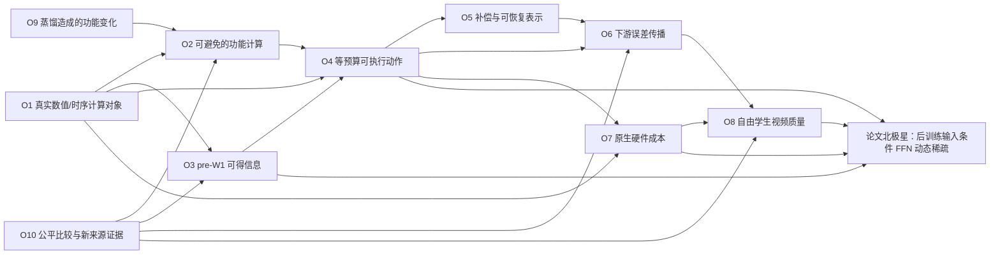
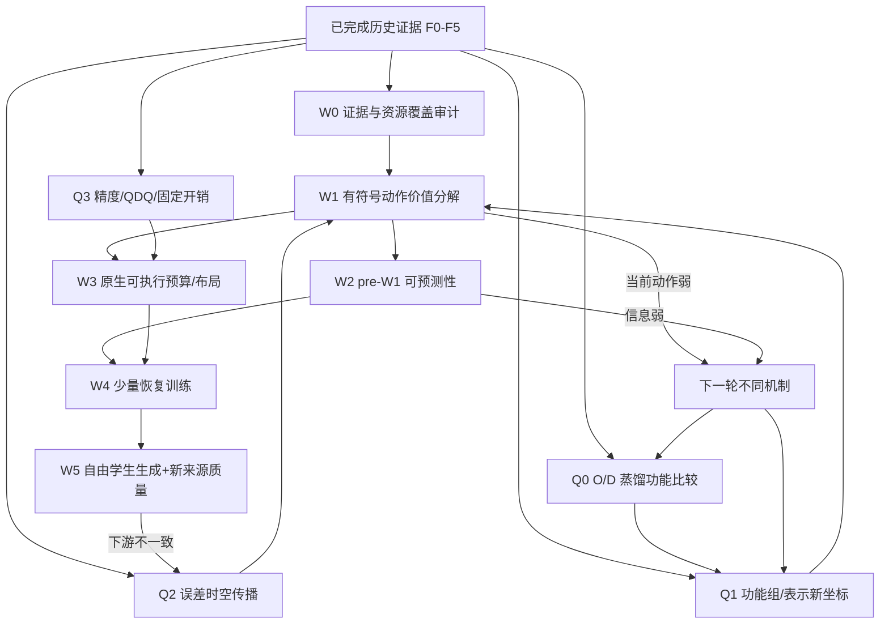

> **FFNDS research-library snapshot · V1 historical evidence atlas.** Historical taxonomy of past methods; use present decision and docs/66 as the newer evidence layer. Earlier planned experiments are not today's execution queue.
>
> Evidence policy: cited prior FFNDS results retain their original provenance; suggested operators and training schedules have **not** been executed by virtue of this import. Do not treat archived "next" instructions or "not yet merged" source-state language as current decisions. Read [the authoritative exploration entry](EXPLORATION_INDEX.md), [docs/66](../../../docs/66_R12等预算动作的操作数与条件粒度审计.md), and [CURRENT_DECISION](../../CURRENT_DECISION.json) first.

---

# FFNDS 全历史机制探索网：面向后训练动态 FFN 稀疏顶会论文的重新建模

**版本**：Review Draft V1，2026-10-22  
**用途**：供研究者审阅的独立研究文档；**不构成仓库决策更新、实验注册、GPU 执行授权或论文结论**。  
**资料冻结点**：FFNDS `b45ef1c5a06881ff0985084a9f134cc6c6e3d920`；AutoResearcher `d24f18091e0ee1f75e5f7ce7fddb7c2f16d6b818`。  
**审查覆盖**：FFNDS `docs/01`—`docs/65` 全部 65 份章节，`research/CURRENT_DECISION.json`、`OBJECTIVE_CONTRACT.json`、`method_triage.json`、R7/R10 失败复盘及关键结构化结果，R12/E0 研究交接，AutoResearcher v2.3 `AGENTS.md`、两份 skills 与核心协议；补充核对最相近的公开论文。审查方式为已发布源码/协议/结果/数据记录的交叉核对和局部数据算术校验，**未重新运行 Wan GPU，也未重新读取服务器 HF 缓存中的全部原始张量**。

---

## 0. 研究上的首要新认识

过去探索中，最关键的矛盾不是“稀疏率还不够高”，而是：**FFN 中存在可观测的局部冗余，但这部分冗余与真实可执行、可预判、可恢复、可在四步生成中安全省略的计算之间没有建立同一个机制映射。**

已经验证的四条事实链：

1. **oracle 与前置信息之间存在落差**：AR2 真实后验 C 选择在局部测试中优于部分静态/随机，但 PR2/PR3 的低成本前 W1 代理不能稳健复现；HP/NP 提高模型容量也不能补足 C 目标的预测价值。
2. **局部收益与下游收益之间存在方向差异**：R7D1 的 3/4 来源发生局部误差排序与 downstream flow 排序逆转；R11T1 用真实 native flow 训练优于匹配 local-fit，但固定方案仍未达登记门槛。真实条件收益可能依赖误差方向、已有基线误差以及传播状态。
3. **省去理论 MAC 与实际完整 FFN 加速不是同一回事**：历史 A5 在完整 W1 后才剪 W2；完整 H 2:4 合成优化后约 1.31×，加修正约 1.20×；UB1 是具有完整链实测 1.546× 的强静态控制，却没有条件路由贡献。
4. **少步视频生成质量是闭环约束**：UB1 在旧正式20三轴通过，来源分离补充20 imaging 下降 3.165968%；UB2 末步全 dense、LR2 末端增秩、VM1 方差修正均未跨过额外来源的 imaging 门槛。不能由相同状态的最后一步零误差推出自由轨迹无误差。

这四个事实**并不**推出“动态 FFN 稀疏不可能”。它们将论文问题重新定位为：

> 在四步蒸馏 Wan 的真实 HiF4/BF16 计算中，寻找一类 **信息在执行前可获得、动作在原生执行中可节省主计算、反事实收益真实存在且受下游生成影响约束** 的 FFN 条件计算机制；随后通过轻量后处理训练实现它。

研究不应预先把 **CBR-FFN/R12 跨层预算转移** 当作唯一答案。它只是探索网中能区分“静态宽度足够”与“输入条件分配有价值”的一个清晰探针。

---

## 1. 工作对象、评价函数与证据语言

### 1.1 三个模型身份与真实计算

- **O**：原始未蒸馏 Wan2.2 I2V A14B，作为蒸馏影响的比较对象；不能直接采用 D 的四步轨迹称作 O 原生轨迹。
- **D-BF16**：LightX2V 四步蒸馏模型，隔离量化影响。
- **D-Q**：同一 D 权重及固定 HiF4 Smooth/activation QDQ/BF16 原生执行链，是静态/动态稀疏的直接部署比较基线。这里的 QDQ 不能自动等同硬件原生 FP4 GEMM。

D 的 step 列表 `[1000,750,500,250]`，high/high/low/low 两专家各负责两个 step，40 个 transformer block；FFN 输入/输出维 `d=5120`，hidden `h=13824=216×64`；研究典型 I2V latent 序列长度 `M=31668`。实际 block 先完成 attention 残差，再 norm2/AdaLN 时间调制，再 FFN0→tanh-GELU→FFN2，并用**当前** gate/residual 写回。

结构记号仅作为分析坐标：

\[
 u=\operatorname{AdaLN}(x,c_s),\quad v=Q_1(u),\quad z=W_1v+b_1,\quad
 h=Q_2(\operatorname{GELU}_{\tanh}(z)),\quad y=W_2h+b_2,\quad
 x^+=\operatorname{NativeGateResidual}(x,y,g_s).
\]

`Q1/Q2` 实际分别包含 Smooth、dtype 转换、HiF4 量化-反量化及相关权重缓存/精度约定；不把上式中的实数运算重排当作逐位等价。**TeacherY** 在 gate 之前，**StudentY** 还可能含 UB1 的 gain/bias/R256。另有 step 间调度器 latent 更新与下游 head。

**严格信息时序**：可部署策略 \(\pi(a_{s,l},s,l,c)\) 只能使用要节省的当前 W1/FFN0 **之前**已生成且付过实际执行成本的信号。先完成 W1 才计算的真实 hidden、后验 top-k、教师输出和完整 downstream 反事实属于标签/oracle，不是免费 selector。

源码与身份：[`docs/08`](https://github.com/Qesire/FFNDS/blob/main/docs/08_上游源码校对_20261020.md)、[`docs/55`](https://github.com/Qesire/FFNDS/blob/main/docs/55_跨步FFN复用的冷启动与配对数据审计.md)、[`docs/63`](https://github.com/Qesire/FFNDS/blob/main/docs/63_原生输出头梯度与零更新等价检查.md)、[`tools/step_budget_runtime.py`](https://github.com/Qesire/FFNDS/blob/main/tools/step_budget_runtime.py)。

### 1.2 科学目标不等于工程验收，不等于诊断代理

**科学目标**：发现四步蒸馏 FFN 的输入/状态条件冗余，提出新 **后训练** 动态 FFN 方法，与最强等预算静态方法比较，并理解为何它有效。

**原冻结工程验收，必须同一候选同时成立**：

| 维度 | 约束 | 不能替代的量 |
|---|---|---|
| 主 FFN GEMM | 真实按行数和矩阵形状计数的总 MAC ≤ dense D-Q 的 50% | 只剪掉 W2 的理论 FLOPs、mask 密度或 FFN output tensor 稀疏度 |
| 完整 FFN 时延 | 同部署完整 FFN 边界加速 ≥ 1.5× | 单独 GEMM、单一 kernel、合成四步样本或整视频 wall time |
| 视频质量 | 真正独立且冻结的新 I2V 来源，稀疏学生**自由四步轨迹**，aesthetic/imaging/motion 每轴相对 D-Q 下降≤2% | 旧 formal20、局部 SSE、同输入 flow SSE、平均分或强制复位教师的诊断视频 |
| 学术贡献 | 相对同 MAC/同恢复能力的**最强固定策略**获得额外条件计算收益和真实可部署方法 | 静态步间预算、已有 dynamic width 或换名的新 router |

以 `EXPLORE → GROUND → TEST/BUILD → CLAIM` 作为证据状态，而不是探索许可过滤器：

- **E0 / STRUCTURAL**：数学恒等、成本下界、真实源码路径。
- **E1 / SAVED-DIAGNOSTIC**：已有张量/记录的再分析；有明确样本暴露与作用域。
- **E2 / LOCAL-NATIVE**：相同输入、精度、量化、gate 的真实 FFN 反事实。
- **E3 / FIXED-INPUT-FLOW**：同一完整 step 输入，经真实下游的 flow 响应。
- **E4 / FREE-ROLLOUT**：策略改变真实学生后续状态。
- **E5 / JOINT-FINAL**：真正未见来源、官方质量、完整速度与条件创新对照共同成立。

任何节点的 `REJECTED` 必须写作 **“该协议所指定的实例/动作族与门槛不通过”**，而不是“同一主题的所有机制全部失败”。

### 1.3 防止混合比较的四种实验单位

1. **独立来源**：一张输入图像及其关联 prompt；多个 seed、token 行、层或官方评分复制文件名，不自动扩大独立样本数。
2. **配对操作数**：相同输入语义/坐标/模型/step，不把同文件中的不同随机行按下标 zip 当作同一 token。
3. **相同模型状态**：D-Q、C24/UB1 自由状态、强制重置后状态不是同一分布；局部教师同输入不等于完整 dense 教师轨迹。
4. **相同可执行预算**：等 group 数/MAC 可能有不同 QDQ、内存/packing/launch、残差训练成本和时间；必须同时列算术与实测。

---

## 2. 全局探索网：结果—机制—新干预不是一条链



**历史证据不是一个标量排名**：AR2 强在 `A` 的后验局部选择；PR2/PR3 暴露 `I→X` 的预测失配；R4E1 测了旧 `X` 邻域/旧 `R`；R7/R11 证明 `R→D` 需要有符号目标；UB1/2 和 LR2 检验 `D→V`；2:4/R9 体现 `X→H`；OD1 只触到 `S→A` 的有限局部切片。

下面的探索网以**节点卡片**和**边表**描述，而不是把一条预想中的新方法当作所有证据的共同解释。

---

## 3. 历史探索全目录：按问题家族重新归档

> 状态取自历史 docs 与当前 `method_triage`，不是根据论文价值进行二次篡改。`✓` 表示该实例所声明的局部/工程检查通过；`×` 表示已注册实例未通过；`◇` 表示诊断完成/新解释开放；`○` 表示未运行或还处于构想。所有括号内数字均限定所列实验作用域。

### F0｜最初双阶段 Proxy / A5+HWG、R3—R27

| 代号 | 曾经改变的东西 | 真实观察与作用域 | 现在对探索网的意义 |
|---|---|---|---|
| A5+HWG 历史 formal20 | 输入分组统计/稀疏 proxy、hidden 稀疏及修正 | 代表配置 s1=.7/s2=.436 的 aesthetic 下降 **2.401886%**，imaging 下降 0.357735%，motion 提升；**完整 W1 后才 mask W2** | 早期视觉质量可以接近 dense，但不能按省下 W1 宣称加速。双级预测需要真正置于 W1 之前才可能达部署目标 |
| R3/R7/R14 | 不同来源、层与 token 采样的原生资产与在线矩 | 建立后续 BF16/量化/门控诊断基底 | 数据数目应以独立来源计，不能把 scope、行、seed 当作等价独立来源 |
| R4/R5/R6/R8/R9/R10 | 结构化支持/残差/2:4、token 路由、影子 CUDA 时间 | 曾有影子执行约 **1.75028×**，但不写回真实生成轨迹 | 影子性能与另一个实现的视频质量不得拼接 |
| R11/R12 | token 半量/相位动作 | 两来源出现极大视频质量下降 | 这些 token/phase 全轨迹配方失败，不等于所有时空粒度无价值 |
| R15 | hidden 半宽 + rank512 | 完整 FFN 约 **1.479407×**，两来源 imaging 约下降45.8% | 残差容量可以降低部分局部误差，却不必然保护少步视频的闭环 |
| R13/R16/R17/R18 | 原生响应、模板、支撑与低秩 W2 读出 | 主要局部数值/表示检查 | 为“选择支持 + 重学 W2”提供强历史近邻，新方案须有实质功能差异 |
| R19/R22/R23 | 两侧 2:4、二阶 W1 拟合、折叠小参数 | 布局/局部数值有先例；没有联合终端胜利 | OBS/2:4 不可以重新命名为创新 |
| R20 | 同专家跨步 FFN 输出复用、标量/通道仿射 | 早有局部探索，非当前 UB1 自由闭环 | 任何缓存研究要正面比较旧 R20 + TeaCache 类思路 |
| R21/R21B/R24/R26 | 置换与量化次序、H/QDQ-aware 分析和视觉反馈 | `permute∘QDQ` 与 `QDQ∘permute` 有原生反例；不能假设交换 | 改变支持/融合/量化表示时需要原 native 数值控制 |
| R25/R27 与 V5 采样 | 视频观察、数值边界/采样失效修复 | 一些视觉差异明确，但不足以完成因果定位 | 视频现象应转化为可重复的时空扰动/频率/区域指标 |

**历史 A5 的关键教训不是“动态双阶段方法没有意义”，而是其后 W1 mask 的质量成功与前 W1 实际省算是两项尚未同时成立的证明义务。**

### F1｜后验贡献选择、前置代理与粒度

| 代号 | 测的机制 | 实测结果/最相关对照 | 现今状态与空间 |
|---|---|---|---|
| AR1 | 已知支持下的标量增益/校正 | 有可迁移的局部收益，非完整动态稀疏 | `◇` 输出幅值校正有用但不足以定义价值 |
| AR2（原 105138） | A/E/C oracle 探索 | 旧作业超时，存在 donor/bias/性能代码问题 | 未完成不能记为阴性；新 AR2 重开另记 |
| AR2 重开 | A/E/C 动态支持 vs random/static，在真实原生 BF16 局部 | **C：Fit 4/4、Validation 4/4**；C/random 风险 0.561–0.682，C/static 0.614–0.810；A 验证2/4、E 验证2/4 | `✓ E2 局部后验 C 可选性`，但 C 需要实际 hidden/输出、且只两独立图像来源；尚未证明 cheap predictor 或完整 FFN |
| PR1 | 简化输入核回归支持代理 | 两来源均不过固定门槛 | `×` 限制该核代理 |
| PR2 | W1 的 SVD 低秩 proxy + GELU/Q2 | 所有 rank 的 Fit 0/4；rank512 Z 相对误差45.2–49.5%；预测成本约 W1 的13.7%（理论） | `×` 限制本固定低秩投影预测 C，不排除其它表示/预测下游收益 |
| PR3 | donor 输入 PCA 代理 | rank512 Fit3/4，Validation2/4；跨来源 Z 相对误差约0.597–0.617 | `×` 输入协方差的训练拟合不等于跨来源稳定预测 |
| CG1 | 原生单通道粒度 vs 64 通道组 | 更高能量保留率，局部风险更低，但 task0 2/4、task6 3/4，未过登记门槛 | `×` 提醒粒度/布局/量化不可只看能量 |
| TC1 | 64-token 连续小块的**单行支持迁移** | 四折同块相对静态的保留 C 收益都为负 | `×` 单行迁移；**未测**整块聚合 signed-native oracle 与可执行 tile |
| RB1 | K-means 四模式路由 | 四折各有小簇，训练前止步 | `○` 不是 router 已训练失败 |
| RB2 | 平衡四 bank C-profile | oracle 相对最佳静态只增 **0.56–0.79 个百分点**，未过预定+2pp；路由增益更小 | `×` 此四种 C bank 的**动作容量**有限；并未证伪其它功能动作族 |
| HP1 / HP2 | h256 的平方特征或 MLP→C-score | 二次特征略逊线性，MLP 明显逊线性；逐行后验 C oracle 自身仍有较大分数空间 | `×` 该特征/标签模型族；不能由此推出 signed native action 可预测性弱 |
| NP1 | 新非线性输入特征预测 C | 四项都逊同输入投影线性对照 | `×` 额外 GELU/QDQ 特征没有带来足够标签改进 |

**重新归纳**：过去至少混合了三个完全不同的问题：`后验 C 排序存在差异吗？`、`pre-W1 低成本信号能预测这个排序吗？`、`排序改善能否兑现 native output / downstream loss？`。AR2 只主要回答第一个。F1 失败集中在第二个和“C 这一代理目标与动作集”的特定实现上。

### F2｜补偿、表示、学生状态与小型训练

| 代号 | 方案实际改变 | 结果/对应范围 | 可以提炼的新结构问题 |
|---|---|---|---|
| C-static / centered | 静态 C 支持 + 非负 gain + bias 中心化 | local native 风险/未中心化约 0.642–0.820；完整 task6 视频仍明显退化 | 静态低阶矩很可恢复，但视频的高阶/方向误差仍存在 |
| RR1 | 当前输入 V1→rank256 残差补偿 | 已显著缓解某些纹理块；正式20 aesthetic **−10.627%**、imaging **−5.113%**，联合拒绝 | 线性补偿可减少一部分误差但未形成稳定质量 |
| C24 | 同总6144行/位置改成24独立校准来源 | 正式20 aesthetic **−9.255%**、imaging **−3.264%**，仍失败 | 来源多样性改善局部/全局表现，不能单独归因“来源数”或“采样行减少” |
| VM1 | 冻结 RR1，匹配输出均值/方差 | local 能量几乎对齐但正式20 aesthetic **−9.854%**、imaging **−4.089%** | 错误不是统一幅值/均值可全部描述；误差**方向**关键 |
| WR1 / JR1 | 重建 W2、联动保留特征与 R256 | fixed native CV 拒绝；JR1 有有限改善 | 支持+读出重建已出现历史先例，简单组合不等于新功能动作 |
| OP1 | C24 学生实际状态上的局部 dense 教师重拟合 R256 | 4项 CV 新/旧误差约 1.026–1.038，反而变差 | student-native input 与目标配对不自动修复动态轨迹/旧支持 |
| OP2 / OP2A/D/R | UB1 **真实学生状态**的原生教师采集和数据/回放检查 | 24来源×160位置×256行，3840 payload，no-op/原生控制成功；C24与UB1状态有差异 | 提供可信的 E1/E2 操作数；**不是**新稀疏算法效果 |
| OP3 | 同 R256 在 UB1 真实状态上重拟合 | 8项均未超过冻结 UB1，较同来源旧状态拟合可能略好 | 单纯“多 on-policy 样本”不能当作恢复机制 |
| LA1 | rank32 QAT/LoRA 更新 W0/W2 | 4项 CV 训练降、验证基本不变 | 增加更新能力而目标/动作不变，收益有限 |
| FA1 / FA2 | 所有保留权重的量化感知更新 8/64 epoch | FA1 验证误差仅改善约3.9–4.5%；FA2 比值约0.864–0.877，未过≤0.8 | 延长同一局部目标训练不是直接解决下游质量的证据 |
| NF1 | 对遗漏 4×64 hidden 新算非线性特征再补偿 | 原生风险改善约5.7–7.3%，但双门槛失败，附加运算贵 | 小量遗漏非线性有恢复信息，但不等于性价比好 |
| NF2 | 已有 h256 读出 + GELU 输出修正 | 8项未过，且逊匹配线性读出 | 不能从这类 output regression 失败推断 h256 不含 **动作收益** 信息 |
| LR1 / LR2 | step3 部分层 R256→R512 | LR1 4项中仅2项通过；LR2 原20质量通过，补充20 imaging 仍 **−3.051%** | 容量增加无法单独修复自由学生生成的来源外问题 |
| R4E1 | 相同支持宽度下16候选组、至多 q=2 交换，匹配 fixed-h 第二层读出 | 四折全部失败；step2 仅 0.36–0.52% 改善，step3 不交换优；保存行 oracle 额外增益至多 0.02798% | 仅关闭该局部支持邻域和拟合协议。收益空间应重新在**不同动作结构**测量，不再自动扩大同一邻域 |

### F3｜静态计算预算、视频反馈与闭环诊断

| 代号 | 作用 | 已有终端证据 | 机制结论 |
|---|---|---|---|
| UB1 | 静态步间25/50/50/75%，原64组、gain/bias/R256；完整两侧半宽/多宽 GEMM | 原正式20三轴下降0.874%/1.345%/0.007%，完整 FFN **1.546111×**；补充20 1.934%/**3.166%**/−0.094%，imaging 拒绝 | 这是应对比的**强静态基线**，不是动态稀疏方法；联合泛化尚未完成 |
| TF2 | 每步复位 D-Q latent 的相同状态 flow 诊断 | 四个来源：更新后相对 RMSE step0/1/2/3≈2.63/2.56/6.44/11.68%；末步 post SSE 最大 | 误差随 scheduler 更新尺度变化，不能直接相加归因到最终画质 |
| UB2 | 25/25/50/100 静态重分配，step3 全完整 FFN | 最后一步相同输入 native 误差0，但补充20 imaging **−4.652%** | 完整末步不消除前面已经改变的学生状态；“最后一步完美”不是自由轨迹充分条件 |
| BO1 | 仅在冻结 UB1/UB2 全视频二选一 | 补充20 即使事后按每来源选最优，最佳 imaging 仍 **−2.909550%** | **严格有限动作集合的上界**：路由不能生成两臂之外的视频；不适用于新的层内/视频内动作 |
| 多类别 UB2 确认 | 前瞻冻结不同类别的新20来源 | 条件前置评估因 UB2 已失败而没有生成正式结果 | 未运行 != 验证失败 |
| 视觉表现/时空异常 | 一些视频主体基本稳定，而背景灯光、细小物体动态漂移、纹理/模糊有异 | 定性开发观察，尚无与误差传播绑定的独立时域因果数据 | 应提出可判别的频率/空间区域/运动补偿误差分析，不直接以平滑当机制 |

**统一质量结果对照（同一冻结 D-Q 参考，每列是相对下降百分比，负号表示候选优于 D-Q）**：

| 候选 | 正式20 aesthetic | 正式20 imaging | 正式20 motion | 补充20 aesthetic | 补充20 imaging | 补充20 motion | 评估说明 |
|---|---:|---:|---:|---:|---:|---:|---|
| RR1 | 10.627 | 5.113 | 0.015 | — | — | — | 只运行原20，拒绝 |
| C24 | 9.255 | 3.264 | 0.329 | — | — | — | 只运行原20，拒绝 |
| VM1 | 9.854 | 4.089 | 0.177 | — | — | — | 只运行原20，拒绝 |
| **UB1** | **0.874** | **1.345** | **0.007** | **1.934** | **3.166** | **−0.094** | 原20通过完整链速度/质量，补充 imaging 拒绝 |
| LR2 | 1.210 | 1.272 | 0.023 | 1.901 | 3.051 | −0.081 | 补充 imaging 拒绝；新独立测速未运行 |
| UB2 | 0.141 | 2.218 | 0.044 | −0.686 | 4.652 | −0.073 | 两批 imaging 拒绝；新独立测速未运行 |

原20和补充20都已经被多轮研究用于开发反馈；表格中“正式”指**原实验历史命名**，不是今天仍可当盲测的最终集。该表也不允许把 UB1 的速度与其它候选的质量拼成同一部署结果。

### F4｜跨层 native 传播与更真实的损失

| 代号 | 检验对象 | 确认的数据 | 对今后问题的含义 |
|---|---|---|---|
| R7D1 | step3 block30/31 同状态全部教师输出恢复、A/B/AB 的下游响应 | 24次原生四步生成；3/4 来源局部误差大小与下游收益排序反转；双层恢复汇总 flow SSE −3.029%，净交互仅约 −0.111% 基线 SSE | **局部 MSE 排序不是 downstream-value 排序**；未证明强烈协同，也不满足50% MAC部署 |
| R7D2 | 两层现有 R256 的两标量增益，local vs secant flow 训练 | 18次原生生成；训练 flow 拟合预计减少 2447.64 SSE，真实仅减少 44.20（兑现1.806%）；开发 flow-fit 不胜 local-fit | 原生 BF16 非线性响应使冻结割线代理方向失配，不能只调节 gain/epsilon |
| R10 保存张量归因 | native vs secant 流方向 | 方向余弦仅约 **0.572–0.575**，真实变化范数为预测约 1.72–1.73 倍；不是 Gram 条件数2.84可解释的小误差 | “用线性代理直接优化真实 flow”缺少原生响应一致性；因果贡献未单独拆成量化/非线性 |
| R11G1 | 原生 final head/flow 对现有 R256 真实反传 | 零更新字节控制、梯度均通过；一次固定 BF16 更新来源内 flow MSE −0.291% | 小规模真实目标训练在技术上可行，不能跳过新目标与路由价值检验 |
| R11T1 | 同样参数、两臂各20次：local teacher FFN vs 真实 native flow | local 自身训练 loss −5.108%，开发 flow **+0.084%**；flow 臂训练 −2.460%、开发 **−1.491%**，相对 local 改善1.574%；仍未过≥2%登记改善门槛 | downstream loss 确实有不同作用，未证明自由轨迹/质量或动态动作的改进；该 fixed20 实例已关闭 |

### F5｜替代表示、量化数值与执行链

| 代号 | 实际表示/成本问题 | 已测值与范围 | 结论 |
|---|---|---|---|
| R6 跨步 FFN cache 准备 | high/high, low/low 两锚点冷启动、OP2 不同采样行配对 | 真正同 token 3908对分散全层；block20 step0→1 仅58对、step2→3 55对；完整输出 Y 缓存约12.08GiB | 不能将行索引相同当跨步配对；该训练准备不足，缓存仍有独立信息机制价值 |
| H1/H2/H3 完整 H 的2:4 | 保留全部非线性，只压两侧乘法 | 合成链优化后 dense/sparse=50.94/38.86ms≈**1.3106×**，加R256约1.20×，未达到1.5×；Q1/Q2约6.17/16.98ms量级 | 激活处理成本大，真正新 kernel 需要改变固定开销，而不只是稀疏 GEMM |
| R8F1 | 仿射骨干完整支持，BF16 vs 额外HiF4编码 | BF16 8/8通过；额外HiF4 8/8不通过 | 失败适用**额外量化版本**，不应追溯否定原 R2 学习型 BF16 算子 |
| R8F2 | group64 Hessian 修复额外 HiF4 | 训练误差约 −77%；完整 native 精度 8项仍拒绝，训练行空间外验证误差约增 5.5–5.7倍 | 数据二阶矩优化可牺牲未覆盖的方向；要分析经验协方差与总体外推 |
| R10 full-H factorization | 保持完整 GELU/Q2 后缩小两个投影 | 同轮合成约 **1.472×**，低于当前1.5×验收；未拟合真实模型因子 | 参数或 MAC 节省≠本机算子延迟；只关闭已测合成实例 |
| R9A1 | 原 R2 学习型 BF16 仿射骨干+残余非线性选组，无R256 | 完整支持数值 **16/16** 通过，最大误差/UB1 0.000811；压缩只 **7/16** 通过，step0/1/2/3 合并 SSE 比约 0.968/1.162/0.750/1.154 | 新表示在 step2 局部有真改善，但 step1/3 退化，可能存在时步/专家功能差异；该贪心方案已关闭 |
| R10 仿射合成成本 | BF16 线性骨干+原生非线性余项、总主MAC=50% | 同轮合成约 **1.6119×**，但无新 native 质量或完整160位置验收 | 有硬件成本潜力，不自动证明可压缩性及学术动态性 |

**资料纠偏**：R10 报告成文时 R9A1 曾是草案；它在后续的 [`docs/62`](https://github.com/Qesire/FFNDS/blob/main/docs/62_广泛复盘后的学习型仿射表示检验.md) **已经实际运行并拒绝**。因此不得再引用早期 R10 “R9A1 尚未运行”的历史快照作为当前结论。类似地，原 R2 BF16 学习表示不能被 R8F1/F2 的额外 HiF4 变体失败自动覆盖。

---
## 4. 数学骨架：将过去的“异常”变成可验证的新自由度

### 4.1 有符号输出群贡献：C-score 为什么不是充分的 native 决策量

对固定一层、同一有效输入，将完成原生 Q2 的 hidden 按可执行组划分，每组贡献（含当前 gate 的局部效果）记为

\[
 c_g(x)=G(x)\,W_{2,g}h_g(x),\qquad
 y_{\mathrm{dense}}^{G}=G b_2+\sum_{g=1}^{216}c_g.
\]

对于保留组集 \(S\) 和独立补偿 \(R_S(x)\)，局部输出差为

\[
 e_S(x)=\sum_{g\notin S}c_g(x)-R_S(x)
\]

（符号取 dense−candidate；各项采用同一 gate/加法定义）。于是

\[
\begin{aligned}
\|e_S\|^2={}&\sum_{g\notin S}\|c_g\|^2
+2\!\sum_{g<h;\ g,h\notin S}\!\langle c_g,c_h\rangle\\
&-2\Big\langle\sum_{g\notin S}c_g,R_S\Big\rangle+\|R_S\|^2.
\end{aligned}
\]

`C-score` 通常倾向第一类对角能量，忽略 **组间有符号内积** 和 **支持—补偿交互**。不同组即便各自能量大也可能互相抵消；高活跃并不等于移除后损失大。R4E1 已测到这类相互作用的有限代理，但是在其 16组 q≤2 邻域中未找到大收益；它不等于对所有组集合、功能子空间或跨层分配的否定。

**推论 → 新问题**：研究能否构造**硬件可打包且有新的 signed-error 几何**的功能组，而非继续用原相邻 64 组进行局部交换？新动作必须和旧支持交换在函数类或信息时序上**不等价**。

**反例**：若只是对 216 组重命名/置换，然后按同样预算选择，且不改变实际量化与执行结构，就只是等价动作参数化，不是新机制；在原生 QDQ 中置换可能还破坏数值等价。

### 4.2 动态性是否有真实价值：从静态—全信息 oracle—前置信息三层精确分解

令 \(L(x,a)\) 为对固定作用域/来源 \(x\) 使用 **同实际成本动作 \(a\)** 的真实损失，动作空间 \(\mathcal A\)。理想条件 oracle 的价值为

\[
V_{\mathrm{full}}=\min_{a\in\mathcal A}\mathbb E[L(x,a)]
-\mathbb E_x\big[\min_{a\in\mathcal A}L(x,a)\big]\ge 0.
\]

这只证明 **存在知道事后标签才能作出的** 输入选择。若执行前允许的特征为 \(\phi(x)\)，最优 pre-W1 信息策略的价值为

\[
V_{\phi}=\min_a\mathbb E L(x,a)
-\mathbb E_{\phi}\!\left[\min_a\mathbb E[L(x,a)\mid\phi]\right],
\quad0\le V_{\phi}\le V_{\mathrm{full}}.
\]

实际小模型 \(\hat\pi\) 的增益还要从 \(V_\phi\) 扣除动作误判的 regret 与采特征、路由、packing 的**真实延迟成本**。因此必须依次区分：

1. \(V_{\mathrm{full}}\)：当前**动作空间**有没有可选择的收益？
2. \(V_{\phi}\)：当前执行前信息足以区分有价值动作吗？
3. 实测策略：预测、迁移到自由学生输入以及 GPU 执行是否仍有收益？

对于**恰好两个动作**，令 \(A(x)=L(x,a_0)-L(x,a_1)\)，则相对于两个动作中更好的固定策略，全信息条件 oracle 的精确收益为

\[
\boxed{V_{\mathrm{full}}=\frac{\mathbb E|A|-|\mathbb EA|}{2}}.
\]

故**均值收益大**未必能发表动态路由：如果所有来源都选择同一动作，\(V_{\mathrm{full}}=0\)，最好的方案是静态执行。另一方面，如果 \(V_{\mathrm{full}}>0\) 却没有早期可用特征能预测 sign(A)，就应研究**新的信息源**，而不是反复扩大相同 C 预测头。

**重要实验单位**：以上的 \(\mathbb E\) 必须规定真实来源分布。当前 4 个曾暴露的开发输入得到的 oracle 只是 **4 输入的经验 oracle**，不能充作未来未见来源上 \(V_{\mathrm{full}}\) 的无偏证明。

### 4.3 有符号下游反事实收益：从局部误差转向动作的边际价值

固定某完整 step 的真实输入 \(x\)，同样原生全步骤执行：\(F_D(x)\)（D-Q dense）、\(F_0(x)\)（UB1）和\(F_a(x)\)（候选动作）。记

\[
e=F_0-F_D,\qquad \delta_a=F_a-F_0.
\]

则相同输出空间的 SSE 改善严格满足

\[
\boxed{G_a=\|e\|^2-\|e+\delta_a\|^2
=-2\langle e,\delta_a\rangle-\|\delta_a\|^2.}
\]

一个动作若降低了某层本地 SSE，但使 \(\delta_a\) 沿错误的下游方向变化，仍可能损害 flow；一个相对 local teacher 的 FFN 差距增大的修正也可能改善 downstream flow。R7D1/R11T1 提供**固定实验范围内**的支持。不同目标还会导致不同参数，因而 R11T1 local/flow 对照不是“仅比较同一输出上的两个打分函数”。

若用一阶传播分析，在当前位置输出误差 \(\epsilon_l\) 和 gate \(G_l\) 下

\[
\delta F\approx J_{l\to\mathrm{flow}} G_l\epsilon_l,
\]

局部 \(\|G_l\epsilon_l\|^2\) 与 downstream \(\|J_{l\to\mathrm{flow}}G_l\epsilon_l\|^2\) 的排序不必一致；还必须考虑当前已有误差对变化的线性交叉项。对实际 HiF4/QDQ/BF16 以及大幅动作，**必须用测得的真实 \(F_a\)** 验证，而不是假设 Jacobian/割线准确。R7D2 的 0.57 方向余弦正是代理失效反例。

**新问题**：能否将 *native downstream action value* 在离线计算为监督标签，再用计算前的输入特征预测？这与 HP1/2 的“预测 C”或 R11T1 的“训练某个 R256 输出头”在**目标、动作与时间顺序**上都不同。

### 4.4 少步四轮动态系统：为什么“末步误差为零”仍未修复视频

令步进动力学为 \(x_{s+1}=\Psi_s(x_s,F_s(x_s))\)。稀疏学生扰动可分解为

\[
\Delta x_{s+1}\approx A_s\Delta x_s+B_s\epsilon_s+\mathcal{R}_s,
\quad A_s=\partial_x\Psi_s,\ B_s=\partial_F\Psi_s.
\]

跨四步递推时，后续状态输入已经因前步误差改变；各步误差项的方向、相乘传播和非线性余项会互相作用，不是四个同状态 FFN SSE 的简单相加。TF2 的末步更新后误差大、UB2 末步 native 完整却视频更差，提示**单步敏感性与前置状态分布**都需要区分。

另对视频中观察到的“主体稳定、背景照明/小物体抖动”，可构造运动补偿后背景亮度残差 \(r_t(p)\)、低频亮度漂移与高频时间谱 \(\mathcal F_t[r]\) 的诊断。但**尚未建立**这些量与具体 FFN 层/通道动作的因果关联；它们是机制判别目标，不应先做 EMA 然后宣称发现根因。

### 4.5 数值精度、协方差和结构压缩

R8F2 观察到 Hessian 校准在训练张成空间内明显降误差、空间外则增加。对编码误差矩阵 \(E\) 和训练二阶矩 \(H\)，标准目标 \(\mathrm{tr}(E H E^\top)\) 不能无代价确保未覆盖方向；增加 \(\lambda\|E\|_F^2\) 是常规 ridge，不应只靠修改 \(\lambda\) 声称新数学贡献。具有解释性的后续问题是：**某些训练分布外方向为何对 native FFN、门控和视频传播更敏感？**

R9A1 还显示 step2 的仿射余项方案局部有效，step1/3 在同预算下显著失败。至少存在三个竞争解释：

- **M-Q1 时步真实非线性差异**：不同 step/专家的 \(h-Q_2\) 余项几何不同；
- **M-Q2 校准分布/动作排序错位**：OLS 激活拟合与经 W2/gate 的目标不一致；
- **M-Q3 执行精度/余项截断与补偿结构**：学习斜率/截距可重构全支持，但有限支持剪裁带来方向性残差。

最小判别为**相同来源和预算**下测余项能量、signed output Gram、每步原生误差方向、外空间占比与 matched alternative support，先从现有 R9A1 保存的派生张量可用性审计开始；这不是自动重开 R9A1 贪心搜索。

**R8F2 的关键可观测分解**（保存的验证输入、FP64 仿射输出 SSE；原 RTN vs 固定 Hessian HiF4 编码）：

| 位置 | 训练行空间内 RTN→Hessian | 空间外 RTN→Hessian | 交叉项 RTN→Hessian | 总 SSE RTN→Hessian |
|---|---:|---:|---:|---:|
| step2/block20 | 6790.04→2810.51 | 809.36→4628.44 | 66.95→322.91 | 7666.35→7761.86 |
| step3/block20 | 6204.84→2494.36 | 705.80→3920.66 | 53.02→277.56 | 6963.65→6692.58 |

**解释**：这个固定编码显著改善已见子空间，同时增加未覆盖子空间误差；相互抵消导致总验证收益很小甚至退化。它不是“训练样本数少所以多采就好”的证明：训练3072行、输入5120维只提供秩上限，实际 trace 有效维约100/108。也没有隔离数据不足、HiF4编码和下游传播的各自因果比例。来源：[`R8F2_transfer_audit.json`](https://github.com/Qesire/FFNDS/blob/main/research/20261021/R8F2_transfer_audit.json)、[`R10_saved_failure_geometry.json`](https://github.com/Qesire/FFNDS/blob/main/research/20261021/R10_saved_failure_geometry.json)。

### 4.6 完整 FFN 的真实成本边界

部署时延至少包括：

\[
 T_{\mathrm{FFN}}=T_{\mathrm{norm/mod}}+T_{Q1}+T_{W1}+T_{\mathrm{GELU}}
 +T_{Q2}+T_{W2}+T_{\mathrm{select/pack}}+T_{\mathrm{corr}}
 +T_{\mathrm{gate/write}}+T_{\mathrm{sync/mem}}.
\]

这是**耗时类别图**，不保证各组件中位数可加。所有候选必须与相同原生/硬件部署的 dense 对照测整条链：

- 完整 W1、只节省一半 W2：若两主 GEMM 等成本且其它开销为0，主 GEMM 加速上限 \(1/(1/2+1/4)=4/3\)，已经弱于1.5×的完整 FFN 门槛。
- 完整 H、两侧2:4：GEMM 理论减少但 native Smooth/QDQ/activation 写读没有随宽度缩减；H3 约 1.31×。
- BF16 仿射骨干 + K 非线性余项：主 MAC 为 \(d^2+2dK\)，与 dense \(2dh\) 比值为 \(\frac d{2h}+\frac Kh\)；已完成合成显示某个形式可能够快，但 R9A1 native 压缩尚未满足局部要求。
- R12 等 group 总数的跨层预算：证明的是**算术主 MAC 相等**，不自动等于原生 CUDA 时间相等、resident pack 占用相等、恢复误差的训练机会相等。

原 UB1 速度约 1.546× 已贴近 1.5× 工程线，新的 selector/多个 packed bank 很容易耗掉余量：必须找出因**重分配、融合或减少既有开销**产生的真实净收益，不能先认定 selector 几乎免费。

---

## 5. 探索节点图谱：观察、机制、候选、反证、下一动作

下面的节点有**多出边**，并明确区分 `SOURCE-VERIFIED`、`NATIVE-MEASURED`、`DERIVED`、`HYPOTHESIS`、`NOT-RUN`。一条分支失败后，按数据指向另一种机制，不将整棵树砍掉。

### 5.1 已有观察节点 O（只存已知事实）

| 节点 | 证据强度 | 记录的现象 | 科学上打开的疑问 |
|---|---|---|---|
| **O-A** | E2/有限样本 | AR2-C 在局部 native risk 上多折优于 random/static | 稀疏支持选择的实际有效信息是什么？C 的提升由能量、组间抵消还是 gate 驱动？ |
| **O-B** | E2 | PR2/PR3/HP/NP 预估 C 有跨来源/容量失败 | 预测目标错位还是可用信息不够？是否存在其它前置特征？ |
| **O-C** | E2 | RB2 四bank C 的条件 oracle 极小 | 静态足够好，还是动作集合构造得太弱？ |
| **O-D** | E2 | R4E1 matched 原生小组交换收益有限 | 应改变支持粒度、功能基或多层预算，而不只是增加相同邻域的 q？ |
| **O-E** | 旧开发正式批的工程联合测量；补充独立批的E4质量反证 | UB1 1.546×，旧20通过，新20 imaging 失败 | 静态容量的时步分配与序列内真正有害误差如何交互？ |
| **O-F** | E4 | UB2 末步 dense、补充质量更差 | 前置轨迹偏差是否主导？静态“末步最敏感”推断如何失效？ |
| **O-G** | E3 | R7D1 局部误差/下游收益 3/4 反转 | 局部排序应否由有符号原生 downstream 收益取代？ |
| **O-H** | E3/E1 | R7D2 割线只兑现预测收益约1.806% | 是下游非线性、精度还是基线状态改变了响应方向？ |
| **O-I** | E3 | R11T1 原生 flow 目标与 local 目标结果不同 | 原生 downstream 目标是否适合作为路由标签/轻训练监督？ |
| **O-J** | E1/E2 | R8F2 Hessian 训练好、空间外转移差 | 哪些方向样本没有覆盖，而哪些方向对视频代价大？ |
| **O-K** | E2/E0 | R9A1 全支持正确、step2 压缩有效而 step1/3 负面 | 余项的时步功能结构是否改变？ |
| **O-L** | E1/E2 | 2:4/full-H 路线 QDQ 处理限制速度 | 执行单元和抽象 sparsity 不匹配？什么 kernel 融合最有潜力？ |
| **O-M** | E2 | OD1 O/D 固定输入 64组贡献集中度极近 | 蒸馏保留的是能量排序、改变的是抵消/条件收益/下游 Jacobian 吗？ |
| **O-N** | E0/E1 | R6 high/high,low/low 冷启动，旧行跨步配对稀少 | 何种跨步历史信息在50%预算下真正可用？ |
| **O-P** | 开发定性观察 | 小物体/照明抖动比主体运动更显著 | 是否存在少量高传播方向，局部 MSE 无法发现？ |

### 5.2 新机制节点 M：真正不同的研究变量

| 机制 ID | 可改变的核心自由度 | 竞争解释与特征预测 | 最小反证（可以失败得有意义） | 对顶会论文的可能作用 |
|---|---|---|---|---|
| **M01 Signed group interaction** | 用 gate 后 \(W_2\) 有符号组贡献+补偿交叉项替代 C 能量 | 若跨组负相关与支持收益相关，能量最佳与 signed 最佳会分歧 | 同来源 native signed Gram 与 C 排序对照；若排序始终相同且误差无改善则不升算法 | 解释性机制，可能支持新可执行组选择 |
| **M02 Functional group basis** | 将相似 signed output 响应映射到新的**可执行、可量化**功能组 | 形成新动作分布/条件价值而非仅重新标组号 | 证明函数类不同；相同 MAC native flow 的 oracle vs 最强固定；否则退为等价重参数 | 可能成为算法核心，但硬件风险高 |
| **M03 Cross-layer equal-budget exchange** | 在固定总组预算下把计算从 FFN B 转给 A，依据输入选择 A/B | 不同来源动作收益的符号交叉 ⇒ 输入条件价值 | 当前 step3 block30/31 的 162/162、216/108、108/216 原生 flow；若全同优选则静态优先 | **R12/CBR-FFN 的具体探针**，不是预选唯一主线 |
| **M04 Conditional budget across steps** | 计算预算按输入特征在四步间动态分配 | 早/末步作用依赖样本而不是仅 step 常数 | 匹配 50%总 MAC 的新步骤策略，同一来源真实自由 rollout；与 UB1/UB2 的有限整视频二选一不同 | 动作广，但训练/轨迹成本更高 |
| **M05 Native downstream action reward** | 将本地 C/MSE 标签换成每动作真实 flow 的 signed gain | E2 oracle 与 E3 flow 排序不同，有意义可预测的 reward | 先离线 E3 标签；若 flow 改善却不改善自由视频，只作为机制探针 | 监督目标贡献，可与 M02/M03 组合 |
| **M06 Early available state sketch** | 输入/modulation/gate/上游 layer 的低成本特征，而非 full hidden | 如果 \(V_\phi>0\)，低成本线性头接近 oracle，增加网络收益边际小 | 固定来源 CV + 离线标签计算 regret；若无可预测增益，信息问题独立打开 | 轻量后处理 router 核心 |
| **M07 Action-conditioned residual** | 补偿器学习 **动作改变后的 signed downstream**，不是独立局部 teacher | 同一训练预算下新补偿能将 conditional advantage 转为 native flow gain | 配对 E3 actions，固定 compensation family/parameter count；若所有动作需巨大补偿退回成本分析 | 改善候选质量但不是单独动态性 |
| **M08 Native-window tiny training** | 保持网络冻结，只训微小 router/读出，直接使用真实 native step/window 梯度 | 比固定局部 FFN loss 有更强部署/同状态结果 | 独立 train/selection 配对，真实 BF16 前向；R11 fixed20 已失败不可换名重跑 | 可能用于让新算法完成质量恢复 |
| **M09 Causal temporal error modes** | 将输入扰动投影到时间频谱/区域稳定性敏感方向 | 相同 FFN SSE 不同方向的扰动导致不同闪烁/照度漂移 | 同原生固定输入注入方向/范数匹配的扰动，对比视频时域指标 | 方法机理与质量解释，避免平均分掩盖 |
| **M10 Distillation-shifted action geometry** | 比较 O/D 的条件动作 regret，而不只比较 top-k 贡献 | OD1 C 相近，但 signed Gram/动作收益/状态变化可能不同 | 配对 O、D-BF16 输入/门控和支持空间；量化因素单独隔离 | 研究科学新意可能很强，但 O 计算重 |
| **M11 Quantization-robust functional coordinates** | 研究 Smooth/QDQ 的尺度、分组边界如何约束功能基 | 若跨尺度组的变换数值不交换，按尺度边界设计新 unit 更稳定 | BF16 vs HiF4 相同 native 重放，改变/不改变分组的受控比较 | 能产生原生 Wan 独特贡献，但很难只靠“重排”成立 |
| **M12 Error outside calibration span** | 让校准追踪总体覆盖和下游关键方向 | 训练 Hessian 成绩与未见损失存在结构交互 | 利用 R8F2 分解区分来源外与相同行未采覆盖，观察对结果的不同影响 | 可能贡献稳健训练，不可只扫 ridge |
| **M13 Nonlinear remainder family** | 以全通道骨干+余项缩小非线性计算 | step2 有压缩空间，step1/3 必须另有结构解释 | 比较不同 step native residual gram、保留额外非线性单位的作用 | 备选静态/动态表示，不自动是输入条件方法 |
| **M14 Full-H factorized projection** | 不删 GELU，改前后投影秩 | 对非线性保留更好，但额外 activation/QDQ 阻塞速度 | 早期成本/精度双筛；合成 1.472× 不够现在的完整 FFN 验收 | 对照表示，不作为优先论文创新 |
| **M15 Cross-step reuse with cold-start** | 用过去同专家同层输出 + 当前小更新近似，保留当前 gate | 某步对短时间变化很小，历史锚点具有条件预测价值 | 真正相同 token 对；比较0阶复用与差分，并测缓存成本/冷启动 | 新信息源但文献竞争强、显存开销大 |
| **M16 Operator fusion / scheduling** | 将 selector、Smooth/QDQ 与 packed GEMM 合作优化，降低固定成本 | 理论 50% MAC 不能兑现时延的原因应可测 | GPU profile 前后“完整链、同 dense 优化”比较，不以组件中位数相加 | 实施不可缺，但单纯 kernel 不是论文完整贡献 |

每个 M 节点允许与**多个**其它节点组合，但组合前要先完成本身的最小判别。举例 `M03 + M05 + M06 + M07 + M16` 是一种可能的新算法链；`M02 + M11 + M06` 是另一条；`M09 + M10` 是科学发现路线。不允许因为尚未解决终端质量，就停止所有结构研究。

### 5.3 竞争假说与实验出边（探索网真正可操作的部分）

| 上游证据 | 假说 A | 假说 B | 便宜的分辨量 | A 被支持时下一节点 | B 被支持时下一节点 |
|---|---|---|---|---|---|
| O-C/O-D：RB2/R4 有限条件益处 | **动作空间弱**，固定支持差异小 | 信息目标错，真实 signed-flow 动作有差异 | 同组/同预算的 native output+flow 行为，不先训练 predictor | M02/M03 扩动作 | M05/M06 改标签与输入 |
| O-A/O-B：C oracle 强、早期预测弱 | C 主要依赖后 W1 信息，难提前得到 | pre-W1 的 gate/conditioning/上游摘要包含新预测信号 | 预测 \(G_a\) 而非 C 的条件 regret，外加特征计费 | M02（新动作） | M06（新特征） |
| O-G/O-I：下游排序和局部不同 | 误差方向交叉项主导 | 一般下游非线性曲率/原生舍入主导 | 实测 \(-2\langle e,\delta\rangle\) 与 \(-\|\delta\|^2\)；原生 secant 残差 | M05 signed 目标 | M08 真 native 反传与窗口 |
| O-E/O-F：UB1/UB2 质量差异 | 早期状态偏移累积 | 后期 FFN 宽度/支持恢复不足 | 冻结同状态与自由运行两类干预，原生 action 对比 | M04/ M09 | M07/M13 |
| O-J/O-K：校准和表示转移 | 非线性余项的跨步结构确不同 | 只是经验支持/样本覆盖和精度问题 | step 内/外 QR、signed Gram、配对原生输出，train-only 选择 | M13 | M12/M11 |
| O-M：O/D 能量接近 | 蒸馏不显著改原坐标贡献 | 蒸馏改有符号抵消、条件动作值或传播谱 | 固定 O/D 同输入 signed regret、gate与 Hessian 谱 | 重新理解 O/D 共同约束 | M10（蒸馏特异贡献） |
| O-P：背景抖动 | temporal 高频敏感方向 | 简单纹理量化/总体图像指标偏差 | 等范数不同方向的 native FFN 扰动及区域时域谱 | M09（动作价值标签） | M11/M12（量化/校准） |
| O-L：2:4 1.31× | QDQ 与 H 写读是主瓶颈 | 实际 kernel launch/layout 造成额外损失 | 实际 profiler、QDQ/packing 融合开关，完整路径计时 | M13/M16（减少全 H） | M16（算子融合） |

> **任何单次实验的结果都要回写节点/边的解释；不要直接把结果扔回“优化 mask”这一抽象大类。**

---
## 6. 实验网络：最小判别组合、依赖关系与双向结果解释

### 6.1 研究推进采用双通道，而不是一条串行路线



主实验资源应集中在一两个最有区分力的 native 动作上；**O/D 几何、功能组推导、时序损失机制、QDQ 代数可以低成本并行**。早期想法不必通过终端验收才值得存在；一旦启动真正模型实验，则对照、来源与执行边界必须冻结。

### 6.2 W0：保存数据到底支持到哪一层？（可立即执行的首轮）

**输入**：已有 E0 JSON、OP2 24来源、TF2 4来源、R7D1/D2 产生的原生下游结果与源码、OD1 O/D 局部资产、R9A1/R8F2 派生张量。  
**首要产出**：一个 `operand_coverage.json` 或 Markdown 表：`source_id / model / step / block / token_shape / state_type / native_dtype / source_sha / producer / can_replay_counterfactual / available_before_W1 / data_exposure`。

核对项：

- OP2 仅对每个位置抽取256真实行，保存的是局部输入与目标，不等于完整 M 的可直接下游 continuation；但它足够重新分析**局部 signed Gram**和已有拟合。
- TF2 保留四来源的完整 step 输入/flow，R7D1 在 block30/31 有真实 native 恢复控制；但 **R7D1 的 A/B 是完整教师恢复，算术预算不匹配 R12 的 216/108**，不能拿它们推算新 action 值。
- OD1 两张独立图像只包含 block20 的固定输入比较，足以重算已有局部 O/D 信号，不足以当作大样本蒸馏分布差异。
- R8F2、R9A1 已有训练/验证、全支持/压缩结果；能否读取完整派生 error vector 需看 HF 缓存具体状态。审查文档本身没有访问这些私有大张量。
- 已记录的新版 R12 E0 `R4E1_summary` 与 `R11T1` 算术复算已经完成；仓库 synthetic oracle 单测的通过**只校验公式，不是 Wan 反事实数据**。

**判别输出**：写出哪些量可以用已存数据计算，哪些必须新增模型采集；避免为了“补全信息”盲目重新生成全部40×4。

### 6.3 W1-A：R12 跨层等预算动作的首次真实判别

| 设计部件 | 明确约定 |
|---|---|
| 目标位置 | 开发先导：`step3/block30–31`，来源固定四条 TF2 已暴露输入 00/05/10/15。选择这个层对源自历史 R7D1；不把先导发现当全层/全分布定律 |
| 冻结参考 | dense D-Q 的同 step input 完整 flow；UB1 75%/75% 并完成对照重放 |
| 三个动作 | `U=(162,162)`，`A=(216,108)`，`B=(108,216)`，单位原生64通道组；各对合计324组 |
| 预算关系 | 两侧主 GEMM 各步同 M、d、权重布局条件下，**层对主 MAC**相同；其它158个位置不动则总主 MAC 名义维持50%。内存、辅助GEMM和 wall time 分别计 |
| 补偿公平性 | 至少两套控制：① **无额外补偿的 raw-native** 三动作；② 相同训练来源、相同容量/更新预算的 **动作专属补偿** 三动作。若继续用冻结 UB1 R256 也可作为第三臂，但不可给某动作更多拟合机会或不计额外内存 |
| 数值身份 | 所有 native Q1、Q2、原 bias、原 gate、BF16 cast/写回顺序固定；U 的 no-op 输出、完整 step latent 与历史 UB1 逐位匹配。A 后 B 接收真实已改变的中间状态 |
| 必记损失 | 每来源局部FFN误差、step flow SSE 到 D-Q、\(-2\langle e,\delta_a\rangle\)、\(\|\delta_a\|^2\)、与其它控制的 pairwise action regret，真实恢复开销和执行形状 |
| 核心判断 | \(\min_a \bar L_a - \overline{\min_a L_{i,a}}\) 是否为正且有可测量的来源/输入动作排序反转；最优固定动作是谁 |
| 实验性质 | 同 step 输入的原生**因果诊断**，**不是**自由四步稀疏学生的最终质量，4个开发输入仅负责机制探路 |

**竞争解释与有信息量的双向结果**：

- `A/B` 相对 U 有改进，但每个来源都选同一动作：这里发现的是**静态预算配置**而非动态性；回到 M02 或 M04 的新动作空间。
- 来源间最佳动作切换且 \(V_{full}>0\)：存在**该层对、该来源、该补偿族**的真实条件 headroom；再执行 W2 信息检验。不要直接训练大模型。
- 局部误差支持某动作、flow 否定它：直接证明该动作集需要 signed native downstream 标签，分析交叉项并进入 M05/M09。
- 原生补偿后所有动作近似相同：当前动作已被恢复函数吸收，可研究补偿非冗余的功能单位 M02 或更改决策粒度；这不是全局不可能。
- 只有 raw-native oracle 好、matched-correction 后消失：条件价值属于补偿前的差距，不能把它当作**实际部署带补偿**的创新优势。

**新模型运行条件**：在 current decision 中注册独立 R12-E1 协议、冻结来源/阈值/补偿/执行器并获得 GPU 作业授权；在此之前该动作尚未实测。不能通过改旧 `step_budget_runtime` 的 UB1 身份分支偷偷运行其它宽度。

### 6.4 W1-B：与 R12 并列的功能组/信号目标对照

为了避免 R12 的一个层对把探索网压缩成唯一选择，允许另一个**先只做 E0/E1** 的正交探针：

1. 使用已有 OP2 full-native TeacherY 的保存采样行计算 gate 后组贡献 \(c_g\) 与组间 signed Gram。观察 C top-k 支持的遗漏误差与组间抵消的关系。
2. 确定 **数学上不同** 的新动作构造：例如把具有相反输出效应但有条件互补的组形成**可打包成连续核执行单元**的“共同选择/共同省略”动作，而不只是调整每组 C 排序。
3. 不必先算出全部216组的全域组合。选择严格预定义的小作用域，与原 C/static 和 R4 匹配补偿，在保存真实行上评估 signed native oracle 以及最好静态同预算动作。
4. 只有一组原生动作的条件价值明确而且可执行后，才建议为其新增全 M 数据。

若实验只改变支持编号/贪心打分但实际函数仍落回 R4 已测邻域，则按照旧路线归档；若新的功能组改变信息/操作时序及下游误差结构，则进入 M02 正式实验设计。

### 6.5 W2：选择器实验为什么必须晚于动作价值

训练标签是 **W1-A/B 真实 native counterfactual losses**；特征来自该动作发生**之前**，不得包含 R7D1/R7D2 事后 flow、完成 W1 后的 hidden、后续 block31 激活、教师输出。对跨层 paired action，最保守决策点为 block30 W1 前。

需要的匹配控制：

| 控制 | 能排除什么解释 |
|---|---|
| `best-fixed-action` | 排除只是找到了一个静态预算调整 |
| `step/block/专家 ID-only` | 排除所谓动态实际上只根据固定层/时间表决定 |
| `cheap input sketches linear` | 测量当前执行前信息的线性可预测度 |
| `same features tiny MLP` | 测量容量改变是否增加可用信息或只过拟合 |
| `random / frequency prior` | 控制路由训练类频不平衡 |
| `post-action full oracle` | 仅表示此动作集合的**离线理想上界** |

报告每来源 action margin \(L_A-L_B\)、正确动作比例、按 margin 加权 regret、未知来源泛化、特征提取及 router 的 CUDA 时间/VRAM/额外 weight bank 费用。**准确率不是主指标**：大 margin 错误比低 margin 错误更伤害真实质量。

判别：若 oracle 大但 predictor 小，定位是 **信息瓶颈**；若 oracle 本来小，定位是 **动作瓶颈**；若两者有效但真实完整 FFN 不快，定位是 **执行瓶颈**；若速度可行但自由视频失真，定位是 **传播/恢复瓶颈**。

### 6.6 W3/W4：恢复、原生部署和学生自由轨迹

**原生执行检查**：

- 预打包所有真实被调用的支持变体；原子权重/scale 原始 hash、每次调用支持身份、两侧 GEMM 的 shape 和 number of tokens。
- 对照 **相同准备优化** 的 dense D-Q 与最强静态 UB1，显式包含 norm/AdaLN、Smooth/QDQ、GELU、修正、pack/launch、gate/residual、resident/offload 差异。
- 若多个 bank 与 selector 造成反复 H2D/显存膨胀，应直接报告，不用另一个只装一个 bank 的 benchmark 代替。
- 任意新后处理训练，在训练前、0更新、最终有效 BF16 权重三个状态分别做同样原生字节/数值控制；训练目标需明确是 local FFN、same-input step flow、短窗口或真实 free rollout。

**传播与生成**：

- 先区分固定 D-Q 状态 E3 与真正稀疏学生 E4 的差距，必要时用 H1/H2/H3 的**合法诊断**定位某步之前的状态反馈。
- 冻结 train/selection/最终来源；旧 12/24 校准、formal20、supplement20、TF2 和 R7 输入都已参与开发，不能再宣称最终未见。
- VBench 三轴、分来源质量分布、失败视频帧、背景亮度/纹理的时频稳定性都应呈现，但时域指标是新辅助解释，不重定义官方2%门槛。

### 6.7 理论与工程的“先后关系”并不是单向强制

- **可立即做**：E0 操作数盘点、R4/R7/R8/R9/R11 已保存数据重新分解、O/D 与 C-score 的数学假说、硬件成本模型、文献差异表。
- **需要一次新小规模 native 验证**：M03 等预算动作真实 downstream 值、M02 新功能组的 native 优势。
- **需要前项有真实空间才合理投入**：轻量 selector 后训练、非局部小恢复训练、融合 kernel 原型。
- **需要冻结候选才做**：真正未见来源自由视频三指标联合验收与跨模型扩展。

---

## 7. 论文贡献的竞争性：什么可能是新研究，什么只是现有组合

以当前文献可验证的范围，需要正面面对以下已有概念：

| 竞争方法（公开一手入口） | 已覆盖的思想 | 本项目必须拿出什么**可证伪差异** |
|---|---|---|
| [Dynamic-in-Few-Step](https://arxiv.org/abs/2607.06631)（2026-07） | 少步蒸馏与 step 特定的结构动态计算/稀疏共同优化、Wan-14B | **冻结已蒸馏 D-Q 后处理**，验证输入依赖的真实 FFN 动作相对等预算最强静态，在原生量化链的端到端效果；不能把“按步宽度”当独创 |
| [DyDiT](https://proceedings.iclr.cc/paper_files/paper/2025/hash/a44a70acd5d0abc1a252ada9719dd06d-Abstract-Conference.html)、[DyDiT++](https://pubmed.ncbi.nlm.nih.gov/41538341/) | 动态 timestep width、空间 token 跳过，少量 fine-tuning 和视频/flow 扩展 | input-conditioned 的 **FFN 算子/收益** 与相同静态 schedule、step-only router 区分；不能只“学一个宽度路由器” |
| [Elastic Diffusion Transformer](https://proceedings.mlr.press/v306/wang26dd.html)（ICML 2026） | 当前 latent 预测 block skip / MLP width，推理 cache；输入动态已有先例 | 不能仅以 sample-level dynamic width 为创新；须展示 signed downstream counterfactual 目标、少步蒸馏量化场景、不同真实行为及硬件实现 |
| [RT-Lynx](https://proceedings.mlr.press/v306/cong26a.html)（ICML 2026） | N:M activation 稀疏、误差补偿、专用 CUDA；线性层加速 | 不只是激活稀疏+补偿；比较能否**在主 W1 之前**决定完整两侧 FFN 省算，以及相同 GEMM/mac/correction 资源下的视频表现 |
| [SVDtrunc](https://arxiv.org/html/2609.04646v1) | 保持非线性宽度的低秩前后投影与任务目标恢复 | 如果使用 M14，应证明新预算/条件价值，而不是重新使用 SVD 分解 |
| [SVD-LLM](https://arxiv.org/html/2403.07378v1)、[SlimDiff](https://arxiv.org/html/2509.21498v1) | 数据白化、协方差/功能组重建与权重恢复 | M12/M13 需新的 native 条件结构、跨来源证据，而非换写 Hessian/ridge |
| [TeaCache](https://github.com/ali-vilab/TeaCache)、[TaylorSeer](https://arxiv.org/abs/2503.06923)、[SVD-Cache](https://arxiv.org/abs/2601.07396) | step 复用/差分、历史信息压缩 | M15 必须证明四步两专家冷启动条件下新的有效信息及显存/延迟闭环 |
| [PPCL](https://arxiv.org/abs/2511.16156)、[TARDIS](https://arxiv.org/abs/2501.10054) | 对部分 FFN 的线性替代、折叠非线性近似 | M13 的 GELU 余项分解不因“后处理”三个字自动新颖 |

上表是**最近竞争边界图**，不是系统性文献计量，也不是对每个方法已在当前 Wan 上跑过的基线。正式论文立项时必须按该方向重新做最新题目/官方代码/主要消融的查重。优先把论文主张落在真正能够区分现有工作的一条**机制-预测-原生执行-独立质量**因果链上。

### 7.1 三种可能的论文叙事，不应混成一篇没有主轴的文章

| 可能主轴 | 论文级科学问题 | 需要的决定性证据 | 当前最大短板 |
|---|---|---|---|
| **P-A：反事实收益驱动的动态计算** | 同预算内为什么不同输入应选择不同 FFN 层/预算？ | Native signed action headroom > best static；pre-W1 小型路由兑现；自由视频速度/质量 | R12 三动作还没有真实 native 输出，先验不可视为发现 |
| **P-B：蒸馏特异的功能稀疏结构** | 四步蒸馏如何改变组间抵消、下游敏感性和可压缩子空间？ | O/D 匹配对照+新可执行功能组+条件动态收益 | OD1 只有两个独立图像和 block20；泛化尚弱 |
| **P-C：时空质量敏感的 FFN 条件计算** | 为什么局部 FFN MSE 小仍出现照明/纹理不稳定？ | 因果干预证明具体 error modes；据此构建新的条件动作并改善时间一致性 | 目前视觉现象尚未定量绑定特定算子/层 |

**推荐保留 A、B、C 三条科学叙事作为互相竞争的构造，而不是将 B/C 当作 A 的“风险备选”。** 若 W1-A 一次真实 native 反事实实验已出现可观 headroom，可优先收敛 P-A；若未出现，P-B/P-C 仍可能提供新的动作空间和真正独立的科研贡献。

---

## 8. 下一次研究迭代的“完成定义”与文件组织

这份探索网本身要为 agent 提供可执行入口，但不将流程写成消极审批。给研究 agent 的实际工作约定：

1. **NOTICE**：先从新一项数值观察提炼最有趣的、能解释历史矛盾的机制，附上证据/推导等级。
2. **MAP_FLOW**：重建这一机制必须依赖的 Wan 真源码节点，输出变量语义、形状、dtype、可用时序、代价与下游边。
3. **DERIVE**：给一条精确恒等式、结构反例或条件定理，使至少两种假说产生不同预测。
4. **EXPAND**：提出更多**信息、动作、表示或训练目标不同**的种子，而不是增加旧方法的 q/rank/epoch。
5. **DISCRIMINATE**：先用既存张量/源码/CPU 完成低成本判别；若确需 GPU，冻结 protocol/身份/对照/经费和来源暴露。
6. **BUILD & LEARN**：如果算法成熟，跑真实 native 与自由轨迹；负结果回填它真正否定的节点和可能打开的另一条边。
7. **REPORT**：用“新增机制认识 → 支持或反例 → 下一项最有分辨力的动作”的次序汇报，并生成证据链接。

建议**将来经审阅后**在 FFNDS 建立（此审阅稿尚未写入仓库）：

```text
research/exploration_network/
  INDEX.md                      # 本文的人类入口、当前图与变更说明
  graph_nodes.json              # O/M/实验/结论分层状态
  graph_edges.json              # 支持/反对/依赖/反证关系与版本
  evidence_ledger.json          # 原始协议/记录/结论/独立来源/精度口径
  paper_tracks.md               # P-A/P-B/P-C 的进退条件、最新先例
  active_discriminators.md      # 同时在做的少量判别任务
  archived_nodes.md             # 历史封闭实例，不删除
```

**节点信息模型**（建议字段，不是自动执行许可）：

```json
{
  "node_id": "M03",
  "kind": "mechanism_hypothesis",
  "scope": "D-Q step3 block30/31 equal-pair-main-MAC actions",
  "inputs_available_before_W1": ["modulated pre-W1 input sketch", "current conditioning"],
  "action_set": ["162/162", "216/108", "108/216"],
  "mechanism": "input-conditioned cross-layer compute allocation",
  "falsifiable_prediction": "the native best action differs by input after matched compensation",
  "evidence_level": "HYPOTHESIS_NOT_RUN",
  "nearest_negative_instance": ["R4E1", "R7D1", "R11T1"],
  "next_test": "same-input native A/B/U, best-fixed vs conditional oracle",
  "status": "EXPLORATORY_SEED",
  "model_execution_authorized": false
}
```

将“图中的开放节点”与原有 `research/CURRENT_DECISION.json` 的“当前可运行模型方法”分离；探索节点无需先成为 eligible，**但任何实际 GPU 方法仍要经过新 protocol 与现有原生验收**。

### 8.1 第一轮 agent 产出的最低有效成果

**W0**：用已存研究证据完成来源/张量覆盖盘点，明确是否能做 block30/31 的同状态完整动作测试；输出精确文件指纹或缺失依赖。**W1**：对跨层等预算与 signed 功能组至少各建立一个明确不同的反事实预测，优先选择能利用已有资产的检验。**W2**：把新问题与已关闭最近协议逐项对照，展示动作/信息/目标的**实质差异**；不要把“尚未证伪”当作成功或自授实验资格。

当研究结果仅是结构性新认识，也属于有效产出；当宣称 **算法有效/论文原创/部署达标**，则严格需要相应 level 的真实证据。

---

## 9. 当前审查结果与建议审阅的关键选择

### 9.1 已足够稳定的结论

- 当前最强可复用工程基线是 **UB1 静态 50% 主 MAC / 旧正式20完整 FFN 1.546×**；其新的来源分离质量仍失败，未完成动态学术贡献。
- **局部误差大小不足以代表下游变化**，不应只靠 C-score/局部 FFN SSE 为新论文选动作；必须分析 signed native downstream 反事实作用。
- 旧 R4 支持邻域、RB2 C-bank、旧 HP/NP/C 头、OP3/LR2/若干 QAT 恢复实例已经有明确失败，不应作为只换名字的“下一阶段首选”。
- 小型 native 目标训练具有可执行准备（R11G1），但固定 R11T1 不达其门槛，不是动态条件选择的正面证据。
- 蒸馏前后 `O↔D` 的现有贡献集中度证据非常有限，不足以把“蒸馏消灭了稀疏空间”或“蒸馏增强稀疏”写成已发现的事实。

### 9.2 我认为最有论文潜力、但还没有完成的三个发现方向

**① 输入相关的有符号反事实计算价值**（M03/M05/M06）：最明确可做真实 native 小型判别，可直接决定是否存在可发表的动态性。  
**② 少步蒸馏对“功能动作收益几何”的改变**（M10/M02）：潜在科学含量更高，能够解释为什么旧 activation-topK 视角不足，但当前 O/D 来源覆盖很薄。  
**③ 下游时空敏感性的低成本先验信号**（M09/M06）：与失败视频的具体异常最贴近，有机会建立更有深度的机制—质量桥梁，但需要先定义因果实验。

这里的“潜力”是 **由现有矛盾直接产生的辨识机会**，不是臆测成功概率。一个机制即使最终证明不存在，也可能为选择下一种坐标/动作提供强约束。

### 9.3 供研究者审阅的四个明确问题（现阶段无需答复即可阅读）

- **科学主轴**：论文首先解释“为什么条件预算优于静态”，还是更深地解释“蒸馏如何改变可省计算的功能结构”？两个主轴各自的决定性数据不同。
- **算法边界**：是否继续以原生整64通道组/整 M 预打包为首个可部署动作，还是允许新的功能坐标/可执行 tile 作为并行构造？
- **恢复训练预算**：第一项真正训练尽量只覆盖 tiny predictor/有限读出，还是预留 native window 的微量梯度更新？不应在尚无 oracle headroom 前自动选择训练规模。
- **评价标准**：冻结原 50% / 1.5× / 每轴2% 作为原始验收，论文还应单独展示整个质量—延迟 Pareto 曲线和**相对最强固定动作的条件优势**，而不是只报单个达标点。

---

## 10. 证据索引与全历史文件覆盖

### 10.1 最高优先级的现行入口（不是旧快照的下一步建议）

- [FFNDS 研究目标契约](https://github.com/Qesire/FFNDS/blob/main/research/OBJECTIVE_CONTRACT.json)
- [当前唯一研究决策](https://github.com/Qesire/FFNDS/blob/main/research/CURRENT_DECISION.json)
- [当前方法处置表](https://github.com/Qesire/FFNDS/blob/main/research/20261021/method_triage.json)
- [AutoResearcher v2.3 agent 指导](https://github.com/Qesire/AutoResearcher/blob/d24f18091e0ee1f75e5f7ce7fddb7c2f16d6b818/AGENTS.md)、[mechanism-research skill](https://github.com/Qesire/AutoResearcher/blob/d24f18091e0ee1f75e5f7ce7fddb7c2f16d6b818/.agents/skills/mechanism-research/SKILL.md)、[research-expansion skill](https://github.com/Qesire/AutoResearcher/blob/d24f18091e0ee1f75e5f7ce7fddb7c2f16d6b818/.agents/skills/research-expansion/SKILL.md)
- [R10 全路线复盘](https://github.com/Qesire/FFNDS/blob/main/docs/61_全路线失败归因与组合方案复盘_R10.md)、[R12 初步论文探索计划](https://github.com/Qesire/FFNDS/blob/main/research/20261022/POST_TRAIN_DYNAMIC_FFN_PAPER_PLAN.md)
- [R10 结构化失败归因](https://github.com/Qesire/FFNDS/blob/main/research/20261021/failure_synthesis_R10.json)、[R10 文献核验表](https://github.com/Qesire/FFNDS/blob/main/research/20261021/method_search_R10.json)
- [R12 E0 存档算术复核](https://github.com/Qesire/FFNDS/blob/main/research/20261022/R12_E0_SAVED_EVIDENCE_AUDIT.json)：只涉及存档数值，不能冒充新 native 结果

### 10.2 65份历史文档的重新归类索引

| 章节范围 | 主题与内部路线 | 作用域、当前状态与应优先看的文件 |
|---|---|---|
| **01—08** | O/D/D-Q 身份、环境恢复、HiF4/Hooks、早期 A5+HWG/R3—R27、近邻文献、源码 | 重点 [`04 前期探索`](https://github.com/Qesire/FFNDS/blob/main/docs/04_前期探索与证据边界.md)、[`05 竞争论文`](https://github.com/Qesire/FFNDS/blob/main/docs/05_近期竞争文献.md)、[`08 源码校对`](https://github.com/Qesire/FFNDS/blob/main/docs/08_上游源码校对_20261020.md)；01/02/03/06/07 是对象、资产和环境边界 |
| **09—13** | worker 实际恢复、AR2 修复/重开、PR1/PR2/PR3 前置代理 | 重点 [`12 AR2`](https://github.com/Qesire/FFNDS/blob/main/docs/12_AR2重开结果与下一步.md)、[`13 PR2/PR3`](https://github.com/Qesire/FFNDS/blob/main/docs/13_前FFN0低秩代理实验.md)；09/10/11 保留启动身份、旧超时与代码缺陷 |
| **14—18** | 正式来源、采样/RNG、C-static、RR1、通道粒度、WR1 | 重点 [`16 C-static/RR1`](https://github.com/Qesire/FFNDS/blob/main/docs/16_全位置校准与残差修正.md)、[`17 粒度/驻留`](https://github.com/Qesire/FFNDS/blob/main/docs/17_通道粒度与常驻计时协议.md)、[`18 WR1`](https://github.com/Qesire/FFNDS/blob/main/docs/18_保留非线性特征的权重重建.md)；14/15 是数据/随机数契约 |
| **19—24** | RR1/C24/VM1/JR1/OP1、正式质量与执行总览 | [`19 RR1`](https://github.com/Qesire/FFNDS/blob/main/docs/19_RR1正式视频与常驻等价结果.md)、[`20 C24`](https://github.com/Qesire/FFNDS/blob/main/docs/20_来源分离的24输入校准.md)、[`21 VM1`](https://github.com/Qesire/FFNDS/blob/main/docs/21_输出方差控制实验.md)、[`22 JR1`](https://github.com/Qesire/FFNDS/blob/main/docs/22_保留特征与低秩残差联合重建.md)、[`23 OP1`](https://github.com/Qesire/FFNDS/blob/main/docs/23_学生状态上的原生局部教师.md)、[`24 总览`](https://github.com/Qesire/FFNDS/blob/main/docs/24_20261021晨间实验总览.md) |
| **25—29** | LA1/FA1/FA2/UB1/补充20 | [`25 LA1`](https://github.com/Qesire/FFNDS/blob/main/docs/25_折叠低秩量化适配小试.md)、[`26 FA1`](https://github.com/Qesire/FFNDS/blob/main/docs/26_全主权重量化恢复小试.md)、[`27 FA2`](https://github.com/Qesire/FFNDS/blob/main/docs/27_固定长程量化恢复预算检验.md)、[`28 UB1`](https://github.com/Qesire/FFNDS/blob/main/docs/28_固定步间计算预算对照.md)、[`29 来源分离`](https://github.com/Qesire/FFNDS/blob/main/docs/29_冻结候选的来源分离补充验证.md) |
| **30—34** | 四bank、HP1/2 与 TF2 | [`30 RB1`](https://github.com/Qesire/FFNDS/blob/main/docs/30_四支持模式路由可行性小试.md)、[`31 RB2`](https://github.com/Qesire/FFNDS/blob/main/docs/31_均衡四模式路由负结果.md)、[`32 HP1`](https://github.com/Qesire/FFNDS/blob/main/docs/32_残差隐藏特征贡献预测.md)、[`33 HP2`](https://github.com/Qesire/FFNDS/blob/main/docs/33_跨特征小网络贡献预测.md)、[`34 TF2`](https://github.com/Qesire/FFNDS/blob/main/docs/34_相同状态下的原生流误差.md) |
| **35—39** | LR1/LR2、OD1、UB2、未运行多类别确认 | [`35 LR1`](https://github.com/Qesire/FFNDS/blob/main/docs/35_末步残差容量检验.md)、[`36 LR2`](https://github.com/Qesire/FFNDS/blob/main/docs/36_末端十层的条件增秩检验.md)、[`37 OD1`](https://github.com/Qesire/FFNDS/blob/main/docs/37_原始与蒸馏权重的固定输入局部对照.md)、[`38 UB2`](https://github.com/Qesire/FFNDS/blob/main/docs/38_固定预算下恢复末步完整FFN.md)、[`39 确认集`](https://github.com/Qesire/FFNDS/blob/main/docs/39_多类别前瞻确认集.md) |
| **40—44** | NF1/NP1/TC1、公开身份、OP2 当前学生状态 | [`40 NF1`](https://github.com/Qesire/FFNDS/blob/main/docs/40_遗漏非线性特征的残差读出小试.md)、[`41 NP1`](https://github.com/Qesire/FFNDS/blob/main/docs/41_非线性输入基的贡献预测.md)、[`42 TC1`](https://github.com/Qesire/FFNDS/blob/main/docs/42_连续小块的支持迁移诊断.md)、[`43 隐私元数据`](https://github.com/Qesire/FFNDS/blob/main/docs/43_公开元数据与私有执行配置.md)、[`44 OP2`](https://github.com/Qesire/FFNDS/blob/main/docs/44_UB1真实状态的原生教师采集.md) |
| **45—48** | OP2 完整审计、OP3/NF2、BO1 有限 oracle 证书 | [`45 复核`](https://github.com/Qesire/FFNDS/blob/main/docs/45_完整原生数据复核与回放控制.md)、[`46 OP3`](https://github.com/Qesire/FFNDS/blob/main/docs/46_真实状态重拟合与导入延迟修正.md)、[`47 NF2`](https://github.com/Qesire/FFNDS/blob/main/docs/47_复用残差隐藏量的输出修正.md)、[`48 BO1`](https://github.com/Qesire/FFNDS/blob/main/docs/48_逐输入预算方案的质量上界与暂停.md) |
| **49—54** | R1/R2 理论、AutoResearcher R3/R4、R4E1 原生拒绝及防回退 | [`49 机制`](https://github.com/Qesire/FFNDS/blob/main/docs/49_20261021_机制演绎与重构R2.md)、[`50 淘汰`](https://github.com/Qesire/FFNDS/blob/main/docs/50_研究路线淘汰审查_20261021.md)、[`51 R3`](https://github.com/Qesire/FFNDS/blob/main/docs/51_AutoResearcher_R3_机制路线重审_20261021.md)、[`52 R4`](https://github.com/Qesire/FFNDS/blob/main/docs/52_机制潜力分辨与可行方向_R4_20261021.md)、[`53 R4E1`](https://github.com/Qesire/FFNDS/blob/main/docs/53_R4补偿感知支持交换的原生筛选.md)、[`54 R5`](https://github.com/Qesire/FFNDS/blob/main/docs/54_已淘汰路线防回退审计_20261021.md) |
| **55—60** | 跨步冷启动、R7 总复盘、真实下游双层、目标分离、仿射/BF16/Hessian | [`55 缓存`](https://github.com/Qesire/FFNDS/blob/main/docs/55_跨步FFN复用的冷启动与配对数据审计.md)、[`56 R7`](https://github.com/Qesire/FFNDS/blob/main/docs/56_全路线复盘与下一步机制优先级_R7.md)、[`57 R7D1`](https://github.com/Qesire/FFNDS/blob/main/docs/57_固定双层恢复的原生传播诊断.md)、[`58 R7D2`](https://github.com/Qesire/FFNDS/blob/main/docs/58_局部与下游目标的双参数原生对照.md)、[`59 R8F1`](https://github.com/Qesire/FFNDS/blob/main/docs/59_仿射骨干的完整支持原生精度检查.md)、[`60 R8F2`](https://github.com/Qesire/FFNDS/blob/main/docs/60_HiF4仿射矩阵的分组Hessian量化修复.md) |
| **61—65** | 全局 R10、R9A1 真压缩、R11G1/T1 真目标、最终目标解释修正 | [`61 R10`](https://github.com/Qesire/FFNDS/blob/main/docs/61_全路线失败归因与组合方案复盘_R10.md)、[`62 R9A1`](https://github.com/Qesire/FFNDS/blob/main/docs/62_广泛复盘后的学习型仿射表示检验.md)、[`63 R11G1`](https://github.com/Qesire/FFNDS/blob/main/docs/63_原生输出头梯度与零更新等价检查.md)、[`64 R11T1`](https://github.com/Qesire/FFNDS/blob/main/docs/64_相同部署预算下的局部与真实flow目标对照.md)、[`65 目标修正`](https://github.com/Qesire/FFNDS/blob/main/docs/65_研究目标层级与R11解释修正_20261022.md) |

### 10.3 未在此轮真实做过的工作

本文未对所有 1559 个仓库文件逐行审计；对其来源报告中声明的历史 CPU/GPU 结果进行了文档与结构化状态核对，未新近重新执行旧 160 位置模型、VBench、完整官方指标或 HF 派生缓存的大张量哈希。在线新论文的真实 W1-A/W1-B/E2/E3 机制实验尚未执行，现有 R12 只有方案、存档算术及合成 oracle 工具。这是 **研究解释和探索网络重建**，不是新的实验结果包。

---

## 11. 一页结论：从历史闭环失败走向新科学发现

FFNDS 已经证明：**在这个四步量化蒸馏视频模型上，FFN 存在局部可被裁减/重建的数值结构；但经典 activation 重要性、有限支持交换、小型残差修正和静态预算本身尚不足以推出稳定的视频质量与输入条件加速。**

当前最有决定性的下一问题是：**保持真实原生执行预算不变，输入条件改变 FFN 的哪一部分计算，能产生相对最佳固定动作的、由先前信号可预测的真实下游收益？**

这句话分成三项可证伪的研究对象：**动作是否有价值**（oracle − best fixed）、**提前信息是否有价值**（Bayes/small predictor regret）、**真实执行是否兑现价值**（全 FFN 时延与自由视频质量）。任一层失败，都指向探索网中一个具体新的数学/执行自由度，而不是把失败笼统归结为“动态 FFN 稀疏没有希望”。

**建议本稿先作为 V1 审阅稿，不直接合并到 FFNDS 主分支**。审阅后再决定是否将图谱拆成 machine-readable `nodes/edges/ledger`、将 W0 注册为 agent 的首项真实科研工作，以及如何收敛 P-A/P-B/P-C 的论文主轴。