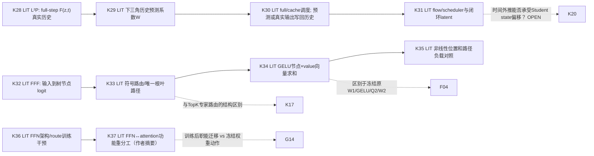

# G9 · 条件执行树、少步历史预测与跨层功能再分配：一手研究与图同步（2026-10-27）

**研究对象**：FFNDS 的 Wan2.2-I2V-A14B 四步蒸馏 high/high/low/low，40 blocks，FFN 为 `q → Smooth1/Q1 → W1[13824×5120] → tanh-GELU → Smooth2/HiF4-Q2 → W2[5120×13824] → e5 gate → BF16 residual`。这是 [G0–G5](../../../docs/98_端到端计算图与证据注解_20261025.md) 的固定原生实现；本文的 **G9/K28–K37 全部为 LIT**，用于提出新的功能表征和严格可区分预测。无新增 Wan native/model/视频运行；原生实验继续处于 [ACTIVE 暂停](../../ACTIVE_RESEARCH.json)。

## 研究增量：区分三种完全不同的条件结构

同一目标“按状态减少实际 FFN 计算并保持完整视频功能”现在有三个正交解释维度：

1. **跨步历史能否替代整个函数值**（L²P）：先学习时间方向的函数轨迹，而不是在当下 token 坐标中删列。
2. **函数是否可用主动路由的低计算复杂度架构表达**（Fast Feedforward/FFF）：训练时把函数表示为树上有限根叶路径，而不是先计算 dense hidden 再后验筛选。
3. **FFN 的功能角色是否取决于其余网络共同训练后的计算分工**（Sparsity Moves Computation）：即使某 FFN 在新架构中稀疏有效，也不能推论冻结的 Wan dense 权重内有同样的可省单元。

与现有 G7 的 [DIFS 逐步训练成组裁剪](../20261026/PRIMARY_METHOD_EQUATION_AUDIT_20261027.md)、G8 的 [SVD-Cache/Chipmunk/Dense2MoE](G8_FOUR_METHOD_PRIMARY_GRAPH_AUDIT.md)相比，G9提出的是**历史线性可预测性 / 树路径计算 / 全网功能重分配**三种互相可检验的机制，而不是另设 SSE 最小化算子。科学目标Q1存在什么信息、Q2取得信息值不值成本、Q3真实省哪部分W1/GELU/W2，依然以[ACTIVE](../../ACTIVE_RESEARCH.json)为准。

## L52 · L²P：可学习的跨步特征预测（K28–K31）

**一手证据**：[CVPR2026发表页面](https://openaccess.thecvf.com/content/CVPR2026/html/Shen_Beyond_Fixed_Formulas_Data-Driven_Linear_Predictor_for_Efficient_Diffusion_Models_CVPR_2026_paper.html)；[作者源码仓库](https://github.com/Aredstone/L2P-Cache) 的 `predictor/train.py`、`src/flux/model.py`、`src/flux/learnable_utils/__init__.py`、`src/flux/l2p_cache.py` 已直接读取（本轮检查的是现行 main，未固定仓库 commit；对应 blob SHA 详见账本）。作者公开摘要及仓库对实验报告 FLUX.1-dev 4.15× latency，但**不是** FFNDS Wan 测值；目前仓库 README 将 HunyuanVideo 复现代码标为“coming soon”。

- **K28 历史真实观测**：在 full-compute 步，完整 Transformer 的最终特征/输出 (f_t=F_{θ}(z_t,t,c)) 经过 `_forward_full()` 计算、缓存。训练离线保存真实轨迹 `features.pt`。
- **K29 轻量后训练**：训练脚本构造 `W∈R^{50×50}`，用下三角掩码按 \(\hat f_{t+1}=\sum_{j=0}^{t} W_{tj} f_j\) 拟合下一时点完整特征，损失 `mean((pred - next_feature)^2)`，Adam lr=0.01/201轮。初值对角为1；这相当于最近一步复制起点。50步历史/固定step schedule是本次作者代码条件；小参数拟合不是完全零训练。
- **K30 在线选择**：`src/flux/model.py` 以 `FULL_STEP_SCHEDULES` 判定 full/cache。cache分支用 `predict_with_learnable` 取下三角对应行与先前缓存特征矩阵相乘；`update_learnable` 将**预测的值也写入历史**。这是**整个 Transformer 返回值**的替代，不能直接解释为选出某些 W1/W2 列。预测若不准确，闭环历史可能继续传播误差。
- **K31 后续动态**：预测的 `f_t` 进入 flow/scheduler 和下一latent，生成轨迹偏移可能改变将来的密集刷新输入。FFNDS已有 NATIVE 的 whole-flow counterfactual、跨 seed 传播为相邻问题，但不证明 L²P 对本 Wan 有效。

**精确代码实现注意**：`learnable_utils.__init__.py` 的 `update_learnable` 在每次 full/cache 输出上调用 `FFT(x)`，保存 `h,l,x` 三套值；当前 `predict_with_learnable` 实际只读 `x`，还从文件读取并 `eval` 权重。故“基于FFT分支的结构预测”不能被当作已在该预测执行中被使用；真实wall应包含这些额外FFT/缓存/文件开销。此处只是作者FLUX源码审计，未做运行时性能核验。

**Wan迁移分歧**：四步里同一 high 或 low expert 仅连续出现两次，跨 expert 换权重；历史为源/step条件函数，不适用50step轨迹分布的直接性能换算。可区分假说：
- H-history：固定 `(source,seed,step,expert,block)` 后，dense真实每步/每层特征的时间变化在极低历史维度内可预测；最小证据是按 high/high、low/low 分组的跨来源/seed留出预测与真实flow差，再看每一步注入方向与门控。
- H-state：使预测似乎成立的是 teacher 前缀共适配；独立Student前缀或小幅latent偏移时系数失效。最小判别是**同源同timestep的 teacher 与 student 状态**分别评估同一冻结系数，并投影到已保存的后续 `v_D(z_S)-v_D(z_D)` 响应方向。
- 物理工作：在cache步替代**整个网络**才节约其W1/W2，若仅替代特定层/FFN需重新定义真实更新和输入合法性；成本包括轨迹缓存 `O(KMD)`、历史加权、可能FFT及IO、刷新频率，不预设效率正收益。

## L53 · Dynamic sparsity in tree-structured feed-forward layers at scale（K32–K35）

**一手证据**：[arXiv:2604.08565v1](https://arxiv.org/pdf/2604.08565) §3 Eq.(1–3)、§5 Eq.的 `FFF_post` 对照、§7 表4–5和作者 §8 limitations。主实验是 GPT-style LLM 训练/微调，并有 DETR 补充；**不是冻结 Wan dense FFN 的免训练稀疏化**。

- **K32 节点线性表征**：P棵深度D的树，访问节点 \((p,\ell,s_\ell)\) 用 \(z_{p,\ell}=x^\top w^{in}_{p,\ell,s_\ell}+b^{in}_{p,\ell,s_\ell}\)（Eq.1）。这是对当前输入的主动训练所得决策值，并非 `W1` 完全dense激活后收集的统计。
- **K33 路径决策**：\(s_{\ell+1}=2s_\ell+\mathbf1[z_{p,\ell}\ge0]\)，`sg` 仅在训练的指示器反传使用（Eq.2）；每树每层只访问一个节点，避免原来其余分支的矩阵工作。
- **K34 输出**：\(y=b^{out}+\sum_{p=1}^P\sum_{\ell=0}^D \operatorname{GELU}(z_{p,\ell})w^{out}_{p,\ell,s_\ell}\)（Eq.3）。具有**有符号value向量聚合**，但其value与 `W2` 原列不同、路由网络本身即在算子定义中。统计path访问偏斜可形成**训练后静态path修剪**，必须按负载与质量匹配。
- **K35 竞争性的激活位置**：作者 §5 把 GELU 放到**稀疏节点贡献求和之后**的 `FFF_post` 版本，缓解训练产生的极端路径偏斜；这改变函数而非实数线性变换等价，因为 φ(Σz_jw_j) 一般不同于 Σφ(z_j)w_j。作者A100表5给 d=6 时 layer 0.35ms vs dense3.03ms（8.7×），同时§8明示是受计算模型/软件实现条件约束的**层级基准潜力**，不得称为 Wan 真实wall。

**关键区别**：Dense2MoE 的 token-topK shared+normal FFN 使用额外路由；FFF 的路由与输出节点绑定，并沿路径串行。FFNDS现有 W1/GELU/W2 同层全宽QDQ输入，不能将树的决策函数套在原 `W1` 列上仍声称两种模型等价。可能的研究问题是：对冻结 dense FFN 的**函数**是否存在低复杂度树/字典近似，且整体 I2V 视频保真；需要小型训练/蒸馏时单独列成本。竞争解释是观察到树训练有效源于**参数/attention共同适配**，而非原模型当前通道天然可省。

## L54 · Sparsity Moves Computation（K36–K37）

**当前证据级别**：[arXiv:2605.09403](https://arxiv.org/abs/2605.09403) 的作者摘要已核；**本轮无法获得完整方法正文/PDF或源码**。摘要报告小型一层Transformer在进位加法、模运算和直方图任务上比较 dense FFN、GLU、MoE/MoE-GLU，并使用 frozen random routing、窄FFN、top-2 MoE 等对照。作者主张 FFN架构/稀疏路由会把部分计算迁往 attention，且随机固定路由可近似学得路由；这是**作者在玩具任务的结论，不是Wan证据**。

- **K36 训练期架构干预**：改变 FFN capacity/partition，同时其他模块继续学习。
- **K37 训练后全网职能再分配**：若注意力承担了一部分原FFN功能，整网质量可以保留，而按旧权重冻结后局部mask则不必然成功。此研究解释为何“一个稀疏架构可训练”与“已有稠密W1/W2某列可无痛删掉”属于两种命题。

最小区分不涉及新 GPU 作业：先核查过去 R7/C1 的残差/attention后续映射是否能作为**冻结权重条件下的跨模块响应**，而非声称已有再训练的计算迁移；提出未来允许的同参数/相同训练数据的联合微调与冻结替换对照。原文方程与具体指标待后续一手深读升级。

## 图G9：函数依赖、信息时点及跨图竞争

| 问题 | 需要的信息 | 省算对象与成本 | 与 FFNDS 最小决定性判别 |
|---|---|---|---|
| 历史函数可预测性 L52 | 当前step、已有full/pred历史，离线少量系数拟合 | skipped full-network计算 vs O(KMD)缓存/预测和full刷新 | high/high与low/low分开；保留seed、历史有效性；比较 `v_D(z_S)` 状态响应 |
| 可表达树结构 L53 | 当前输入上的串行路由节点，训练所得树参数 | 活跃树路径而非原dense列，访存/dispatch/串行树开销 | frozen原函数 vs 学出的结构函数；流动gate/residual实际后果 |
| 模块职能迁移 L54 | 训练期 FFN架构及attention变化 | 改变**模型本体**的总计算图，非原生冻权单层跳算 | 冻结 FFN动作与协同训练分别求证；抽象结论先保持LIT-ABSTRACT |

**竞争结论**：跨步低维**函数轨迹**、单次输入的**条件路径表示**、跨模块的**训练后功能迁移**可同时成立，也可分别失效。下一轮检索应先收集L54完整原文/源码，并将L²P 与 SVD-Cache 的历史使用、refresh、误差积累做同轴方法比较；无需预选 affine54、TopK 或某种量化格式。新模型执行保持暂停。

## 资料与版本

- L52 CVPR原始发表页/作者 GitHub README 和直接读取的 `src/flux/model.py`、`src/flux/learnable_utils/__init__.py`、`predictor/train.py`（详见本目录 [源级账本](G9_METHOD_SOURCE_LEDGER.json)）。
- L53 arXiv:2604.08565v1，直接阅读 PDF §3 Eq1–3、§5 FFF_post 与 §7 Table4–5。
- L54 arXiv:2605.09403 官方作者摘要，全文未取得；不得升格为method-verified。

三种论文贡献都是**机制比较输入**；任何未来方法进入真实 G0–G5 的执行实线时，单列：是否需要训练、可用时点、跨专家合法性、实际QDQ/Kernel/W1-W2省算、160-site/全生成真实时间、帧时空/官方VBench/人工视频质量。
